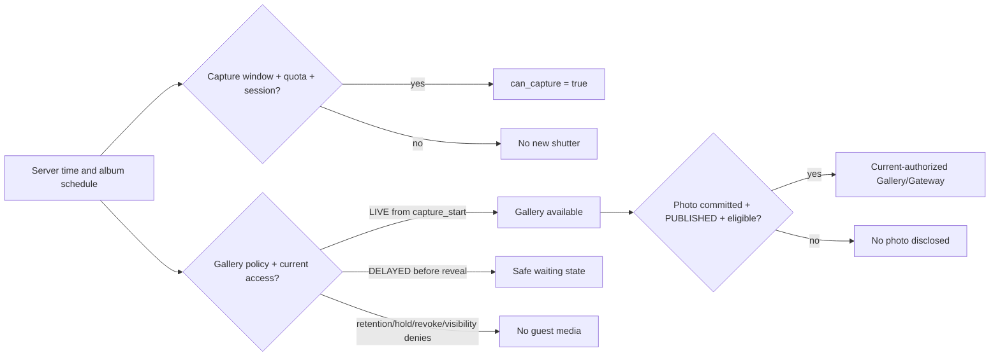
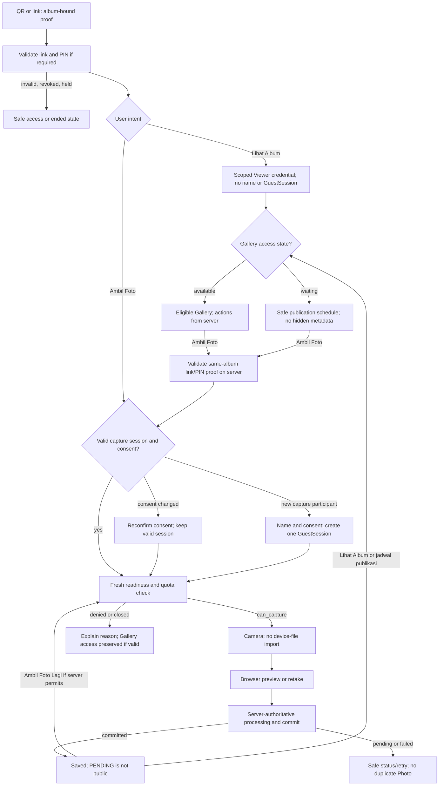
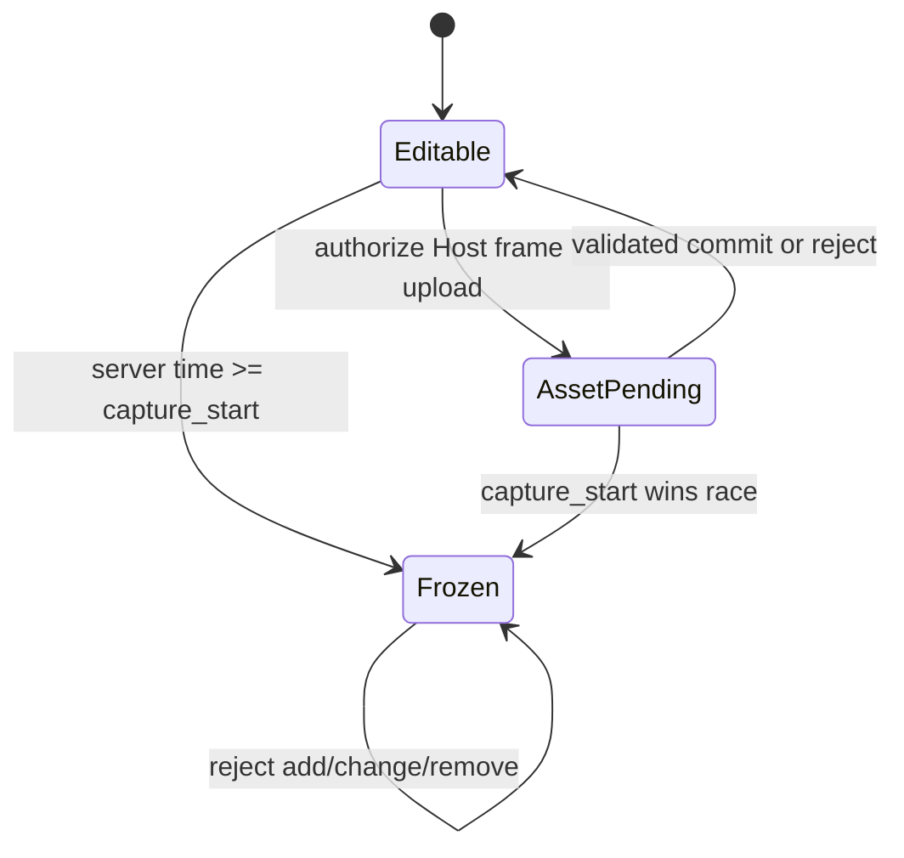
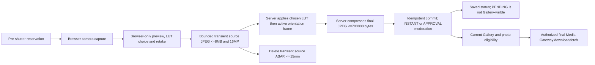
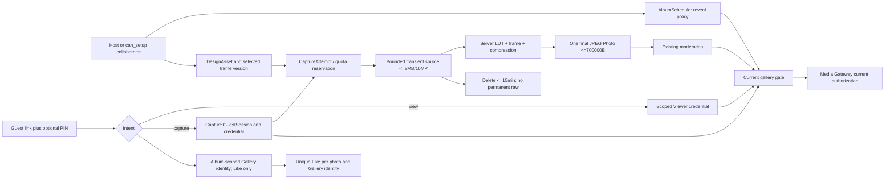

# Kepotret product and architecture contract v0.6 — integrated change addendum

**Status (23 October 2026):** Phase 1 documentation and audit only. Owner-approved PD-01–13, architecture **design Gates A–G**, and amendments **P-01/P-02** are locked target decisions. The proposed wire format, schema, cookie topology, operations and rollout mechanics still require engineering/security review; none is implemented or authorized for backend release. Backend stays **ON HOLD**. Phase 2 frontend work requires separate Owner approval after this Draft PR is reviewed.

## Source baseline and evidence

Current audit baseline: fetched `main` at `bff66de23332f0600acbcdd4bc6895ec4a4c21c2` (PR #43 merged, 23 October 2026). The Owner-approved `Kepotret_v0_6_Consolidated_Frontend_First_Handoff_Approved_2026-10-23.md` was read in full. It supersedes the older Gate G handoff and the prior proposal status of P-01/P-02. The original v0.6 audit package was read in order: `01_OWNER_PRODUCT_DECISION_ADDENDUM.md`, `02_ARCHITECTURE_API_IMPACT_AND_DECISION_GATES.md`, `03_CODEX_CONTRACT_AUDIT_ENGINEERING_BRIEF.md`, then its `README.md`, under `Downloads/Kepotret_Product_Architecture_Contract_v0_6_2026-10-23/Kepotret_Product_Contract_v0_6/`.

Approved baseline documents inspected under `Downloads/SELF EMPLOYEE/DOKUMEN KEPOTRET/`: PRD v0.5 Final; BPMN & Use Case v0.5 Final; DFD & ERD v0.5 Final; Permission and Authorization Model v0.2 Final; System Architecture v0.3 Final; Physical Database Design v0.3 Final; API Contract v0.1 Final; and Technology and Provider Selection v0.2 Final. Repository evidence: [`contracts/openapi/Kepotret_OpenAPI_v1_Baseline.yaml`](../../../contracts/openapi/Kepotret_OpenAPI_v1_Baseline.yaml), [`contracts/openapi/README.md`](../../../contracts/openapi/README.md), generated client/types (read only), `src/features/guest/{components,capture}`, `src/features/host/{components,schedule-validation.ts}`, route catalog, and prior FE-UAT handoffs. The addendum supersedes older rules **only where it expressly says so**.

The original `1. Kepotret_Final_Frontend_Recheck_Seluruh_Halaman_2026-10-22.xlsx` workbook was inspected read only. Its `01 Final Recheck` sheet contains `UAT-FINAL-001` through `UAT-FINAL-102` (102 IDs). The updated Owner workbook, available locally as `2. Kepotret_Final_Owner_Recheck_V2_08_2026-10-23.xlsx`, adds `UAT-FINAL-103` through `UAT-FINAL-107` in its `01 Recheck 31` sheet: together these sources cover the 107 Owner audit IDs. The remediation request names a `(1).xlsx` copy, which was not present in the accessible Downloads tree; the available workbook contains all five specified rows and their Owner comments. Its `hasil_owner` and `status_engineering` cells are blank for those rows. The sheet title and historical `02 Approved 71` sheet do not establish approval for the five additions or final v0.6 frontend acceptance.

## Audit findings

| Severity | Finding | Evidence and disposition |
|---|---|---|
| **Critical** | A naive Live implementation could expose a committed but PENDING/HIDDEN/deleted photo, or serve a previously issued ticket after hold/revoke. | PRD BR-08/FR-12/FR-13, Permission §8, Architecture §10 and OpenAPI Guest Gallery/Media Gateway require current authorization. Gate E's product policy is approved; a shared server eligibility predicate and Gateway enforcement remain unimplemented. |
| **High** | Existing schedule schema only permits `{1,3,5,7}` and `RevealState` alone cannot express Live while capture is open. | OpenAPI `ScheduleWriteRequest`, `AlbumSchedule`, `RevealState`; Host schedule choice. Gate A/G design is approved, but the explicit wire shape and pre-launch cutover are not. Never encode Live as `delay=0`. |
| **High** | Current Gallery requires `/guest/me`, which returns a named capture `GuestSession`; the target Viewer must remain separately scoped and can Like/Download/Share when policy permits. | OpenAPI `GuestContext`, `GuestSessionCreateRequest`, Gallery `GuestCookie`; PRD BR-25 and Permission §8. Gates B/E and P-02 supersede the earlier read-only Viewer recommendation, without granting capture rights. |
| **High** | A browser-composited JPEG plus claimed LUT/frame IDs cannot prove the actual pixels include those effects; the current local success download can bypass publication and Host permissions. | `capture-processor.ts`, `guest-entry-flow.tsx`, direct R2 flow in Architecture v0.3. Gate D approves authoritative server composition; P-01 approves final-media-only download. Transient ingest and scale remain unverified. |
| **High** | Frame mutations must fail at the server clock boundary, including asset upload/commit and concurrent schedule edits; disabling a UI button is insufficient. | PD-11, current cover-only design API. Versioned design/freeze proposal and race tests, Gate C/G. |
| **Medium** | The cover contract permits MIME and a 5 MB maximum while the frontend checks type/size; required intrinsic 1920×1080 and two true-alpha frame variants still need a server contract and byte-level policy. | `DesignAssetAuthorizeRequest` is `COVER` only; `design-setup.tsx` checks type/size. Gate C/F approves both orientations and a separate ≤4 MB cap per frame. |
| **Medium** | H69 hides camera switch when `enumerateDevices()` does not expose a second ID. | `guest-entry-surfaces.tsx:96`, `guest-entry-flow.tsx:658`; PD-13 overrides this. No backend endpoint required. |
| **Low** | The original final workbook ends at 102; five later Owner comments appear in the updated recheck with blank result/status cells. | Keep source versions distinct and do not infer approval from the new rows. |
| **High** | Viewer→Capture may lose the QR fragment after route changes; the current entry route without a fragment calls `/guest/me`, which Viewer cannot satisfy. | `guest/routes.ts`, `guest-entry-flow.tsx`; Gate B requires a server-validated, same-album link/PIN proof exchange before capture onboarding, never a Viewer-cookie privilege upgrade. |
| **Medium** | The new handoff's public-page labels differ from the checked route catalog. | `surface-registry.ts` and `Kepotret_Frontend_Final_Traceability.md`: `/cara-kerja` is H02, `/harga` H03, `/faq` H04, `/keamanan` H08; H06/H07 remain legal drafts. This document uses verified route codes without altering the Owner's behavior decisions. |

## 1. Owner-approved product change matrix

**Status legend:** **OWNER APPROVED / DESIGN APPROVED** locks the target behavior, not implementation. **TECHNICAL PROPOSAL** suggests a contract or data representation for later review. **BLOCKED/UNVERIFIED** denotes missing implementation, integration or evidence. H-numbers identify verified UI surfaces, not approval of frontend/backend completion. The decisions below expressly override conflicting delayed-only, read-only Viewer and browser-final assumptions in the older baseline; all other locked rules remain.

| Product ID / status | Approved rule and affected page | Superseded or preserved baseline | Technical proposal / implementation dependency |
|---|---|---|---|
| PD-01 **OWNER APPROVED** | Five choices: Live, D+1/3/5/7. H29; H07 legal copy remains draft. | Supersedes PRD BR-06/FR-03 delayed-only choice; BPMN-05 delayed-only reveal; OpenAPI schedule enum. | Explicit `LIVE`/`DELAYED` policy, no numeric zero. Gate A/G design approved; wire shape pending. |
| PD-02 **OWNER APPROVED** | New albums default D+1. H29. | Current Host `schedule-setup.tsx` initializes `1`, already aligned; no real historical production album is assumed. | Server default and omitted-field behavior must be specified. Gate A/G. |
| PD-03 **OWNER APPROVED** | Live can expose committed, moderation-eligible photos during the event; capture still ends at `capture_end`. H29/H73; H07 legal copy stays draft. | Narrowly supersedes PRD BR-08/FR-12 “only after reveal” and BPMN-05. Preserves PRD FR-13 moderation, Permission §8, Gateway current authorization, hold. | Separate gallery availability from capture and per-photo eligibility. Gate A/E design approved; contract and enforcement pending. |
| PD-04 **OWNER APPROVED** | Delayed Gallery publication occurs at `capture_end + N × 24 hours`, where N is 1, 3, 5 or 7; reveal changes neither shutter nor retention. H29. | Preserves delayed portion of PRD BR-06, five-minute authorized grace, D+30/D+37/D+51 lifecycle. | Derived `reveal_at` remains server owned. Gate A/G. |
| PD-05 **OWNER APPROVED** | “View Album” and “Take Photo” are separate; a valid returning capture session reuses name and still-valid consent. H64/H65. | Narrows current single guest-entry flow. Preserves PRD BR-01 name/consent **for capture**, existing session expiration and revocation. | Intent routing + capture-context revalidation; no duplicate GuestSession. Gate B. |
| PD-06 **OWNER APPROVED** | A new Viewer may access available Gallery via link/QR and PIN if required, without name or capture session; Viewer Like/Download/Share follow Host and photo eligibility. H64/H65/H73/H74. | Supersedes current Gallery dependence on `/guest/me`/`GuestCookie` and the old read-only Viewer proposal; preserves link/PIN, moderation, hold and lifecycle. | Distinct scoped Viewer credential and server-derived action flags; no capture authority. Gate B/E design approved. |
| PD-07 **OWNER APPROVED** | Viewer has no capture/upload/moderation rights and never enters participant count. H64/H65. | Preserves PRD BR-25 count by pre-end capture `GuestSession` IDs, duplicate names allowed. | No viewer row in `guest_sessions` or capture quota ledger. Gate B. |
| PD-08 **OWNER APPROVED** | Cover: 1920×1080, 16:9, JPEG/PNG/WebP. H58. | Extends current cover-only MIME/5 MB authorization with intrinsic geometry. Existing 5 MB limit is baseline **cover** limit, not frame limit. | Validate dimensions and actual decoded bytes client + server. Gate F. |
| PD-09 **OWNER APPROVED** | Optional Host PNG frame is off by default; activation requires **both** validated true-alpha variants, portrait 1080×1440 and landscape 1440×1080. H32/H58. | Extends `COVER`-only design asset contract; no arbitrary guest upload or silent missing-orientation fallback. | Private orientation asset IDs, ≤4,000,000 bytes each and atomic activation/freeze; Gate C/F design approved. |
| PD-10 **OWNER APPROVED** | Host controls frame; Guest picks one system LUT preset per photo including Normal. H58/H69. | Supersedes PRD FR-02A/FR-08 Host-selected filter wording; preserves Host design ownership and camera-only capture. | Versioned preset identity and processing snapshot. Gate D. |
| PD-11 **OWNER APPROVED** | Frame configuration freezes at server `capture_start`; no add/change/remove then or later. H58. | Existing design API has no frame or freeze. Schedule/reschedule policy remains otherwise unchanged. | Guard authorize, commit and selection under server clock/revision. Gate C/G. |
| PD-12 **OWNER APPROVED** | Browser capture/preview → authoritative **server** LUT → frame overlay → JPEG compression → idempotent commit → eligible Gallery; only final JPEG ≤700000 bytes persists as Photo. H58/H69–H71. | Preserves PRD BR-04/05, FR-09 reservation/idempotency and no device import; supersedes browser-final direct PUT as the v0.6 final-photo path. | Transient source ingest ≤8,000,000 bytes/16MP, cleanup ≤15 minutes, processing profile and queue remain implementation proposals. Gate D/F design approved. |
| PD-13 **OWNER APPROVED** | Camera switch always visible, effective when supported, honest fallback; immersive fullscreen. H69. | Supersedes current conditional switch rendering; preserves camera permission/track cleanup. | Client capability/stream state only, no API change. Physical-device evidence required. |
| P-01 **OWNER APPROVED 23 Oct 2026** | After authoritative commit show **Foto berhasil tersimpan**; APPROVAL shows **Menunggu persetujuan**. Offer **Ambil Foto Lagi** only if server permits and **Lihat Album** when accessible, otherwise **Lihat Jadwal Publikasi**/waiting. Official download is only via authorized final Gallery/Media Gateway when photo is eligible and Host allows. H70–H74. | Supersedes success-screen `Simpan ke perangkat` from browser-local `committedPhoto`/Blob. Delayed, PENDING, HOST_ONLY, Hold and revoked states cannot be bypassed. Browser screenshots cannot be prevented. | Server commit/processing status, action projections and Gateway enforcement need separate contract/security review. |
| P-02 **OWNER APPROVED 23 Oct 2026** | One stable anonymous **album-scoped** Gallery identity supports Like-once across Viewer↔Capture in the same recognized browser/session; no Unlike. H64/H65/H73/H74. | Supersedes `(photo_id, guest_session_id)` as the *sole* Like subject for v0.6 and the prior proposal to deny all Viewer actions. Identity does not authorize Gallery, capture or media, does not count as GuestSession and is not proof of a human across devices. | Candidate `gallery_identity_id` and logical unique `(photo_id, gallery_identity_id)`; issuance, retention, schema and abuse limits need technical review. |

### Existing invariants not changed

Guest names are non-unique and not credentials; capture uses browser camera only; no device-storage photo import; no shutter after event end; album start ≤3 calendar months from creation and duration ≤5 days; Free30 and maximum 10,000 photos; soft-deleted photos count against quota; upgrade/payment cutoff is `capture_end - 120 minutes`; no refunds; final guest count is by eligible `guest_session_id`; authorized upload grace ≤5 minutes; media current authorization and Operational Hold remain effective; normal guest access ends D+30, Owner recovery ends D+37, residual backup cleanup by D+51. Host/WO permissions and privileged Admin model remain unchanged. None of these are a proposal to reopen rules.

### Final recheck crosswalk and evidence limit

The original 102-item workbook, sheet `01 Final Recheck`, maps `UAT-FINAL-007`→H07 (copy), `029`→H29 (chips instead of dropdown), `058`→H58 (navigation and cover dimensions), `064`→H64, `065`→H65, `069`→H69 and `073`→H73. Its `catatan_owner` cells for 064/065/069/073 are empty; the v0.6 requirements come from PD-05–13 and the later Owner comments below, not from invented original comments. The updated recheck adds these five IDs. Their text is transcribed verbatim from `catatan_owner_recheck` (column I); `hasil_owner` (H) and `status_engineering` (K) are empty for each, so no approval or implementation status is assigned here.

| Updated ticket | Page / traceability | Scope |
|---|---|---|
| `UAT-FINAL-103` | H69 → PD-13 | Camera switching |
| `UAT-FINAL-104` | H69 → PD-10/PD-12 | System LUT choice and processing |
| `UAT-FINAL-105` | H58 → PD-09/PD-11/PD-12 | Transparent Host frame, freeze and final output |
| `UAT-FINAL-106` | H64/H65 → PD-05/PD-06/PD-07 | Gallery viewing without repeating capture entry |
| `UAT-FINAL-107` | H27 album overview (the workbook's page-code cell contains its route URL) | Separate frontend accordion follow-up; outside the v0.6 backend contract scope |

**UAT-FINAL-103 — original Owner comment:**

```text
Saya belum melihat button untuk switch kamera depan
```

**UAT-FINAL-104 — original Owner comment:**

```text
saya belum melihat button uintuk filter pada kamera. Saya sudah sampaikan di awal, bahwa perlu ada fitur filter LUT pada kamera. Pastinya ini berkaitan dengan backend, kamu catat dan siapkan buttonnya saja, agar bisa dilihat sementara di frontend
```

**UAT-FINAL-105 — original Owner comment:**

```text
Seingat saya, saya sudah sampaikan ini diawal. Saya ingin ada fitur setup frame juga pada foto, sampul album tetap diperlukan. Setup frame atau bingkai adalah host bisa mengatur atau menyiapkan frame/bingkai dalam format png (dengan transparant pada kotak tengah), yang mana nantinya setelah frame/bingkai ini diatur, para tamu/peserta setelah mereka melakukan foto pada kamera, hasil output/fotonya otomatis akan ada frame/bingkainya. Pastinya ini berkaitan dengan backend, kamu catat dan siapkan menu/card untuk setupnya saja, agar bisa dilihat sementara di frontend. Saya lampirkan refrensi gambarnya. berikan juga informasi size pixel untuk frame/bingkai, berapa kali berapa (px) untuk ukuran frame yang direkomendasikan oleh system.
```

**UAT-FINAL-106 — original Owner comment:**

```text
bagaimana user tamu/peserta dapat melihat album setelah akses url/scan qr? pastikan user tamu/album bisa dapat melihat album tanpa harus melewati proses photo atau open kamera atau mengisi form nama "lagi" terlebih dahulu.
```

**UAT-FINAL-107 — original Owner comment:**

```text
Pada halaman ringkasan album, untuk card Dokumentasi, Acara, Pengaturan, Pembayaran & Paket -> bagaimana jika dibuatkan card Collapse/Accordion (button-button dibawahnya baru bisa diklik setelah collapse/accordion dibuka), tujuannya agar pada halaman ini tidak terlalu padat dan card "draft album" tidak terlalu kebawah.
```

H07 is the Terms of Service page in the route catalog. PD-01/03 require accurate public explanation of reveal behavior there, but **do not** make its legal draft effective or waive separate legal approval. H27, H42, H58 cover guidance, footer WhatsApp, Guest ZIP, H80 server sort and H91 revoke MFA remain separate follow-ups or dependencies. The matrix does not reclassify those as v0.6 backend scope.

## 2. Flow and state proposal

**OWNER APPROVED / DESIGN APPROVED:** PD-01–13, Gates A–G and P-01/P-02 behavior. **TECHNICAL PROPOSAL:** the state names, wire shapes, credential issuance and sequencing details below. Existing backend and OpenAPI do not implement these flows. Every authorization uses current server time, album/photo state, access version and actor permission.

### Independent clocks and eligibility

`capture_start` opens capture, `capture_end` closes new shutter, and an already authorized attempt may finish only within the existing five-minute grace. **OWNER APPROVED:** `LIVE` Gallery can open at `capture_start` while capture remains OPEN; `DELAYED` Gallery opens at server-derived `capture_end + N×24h` for N ∈ {1,3,5,7}. Gallery access and shutter readiness are independent; **never derive `can_capture` from `reveal_state`**. A Gallery that is open need not contain a visible photo: each photo must be committed, `PUBLISHED`, not deleted/purged, allowed by Host visibility, lifecycle, access version and Operational Hold. Gateway repeats authorization at byte fetch. Empty eligible Gallery is valid. Host pre-reveal access retains its separately authorized path. A countdown is display-only, never an authorization clock.



The two server projections are independent: `capture_end` does **not** close a Live Gallery by itself; a camera quota failure does not remove lawful Gallery access. In Delayed mode, the Gallery becomes available at its own reveal time, possibly after capture closes. Operational Hold, revoked link/PIN/credential, moderation changes and retention can deny access at any point. No scheduled job may publish media without rechecking current state.

### Guest entry: two user intents



**OWNER APPROVED:** Viewer gives no name or capture consent, creates no GuestSession and does not enter `guest_count_final`. Both Viewer and Capture Guest may Like, Download and Share **only** under Host settings, photo eligibility and current authorization. A Viewer credential never satisfies `/capture-attempts`, `/guest/me` capture authority or upload. A returning valid Capture Guest reuses the same album session while consent remains current; changed consent requires reconfirmation without repeating a still-valid name. A Viewer selecting **Ambil Foto** must prove the same album/link/PIN to a server-side capture-onboarding exchange even if the URL fragment was consumed; the Viewer cookie alone cannot elevate scope. **TECHNICAL PROPOSAL:** credential storage, proof exchange endpoint, cookie topology and consent-update operation require security/API review. If proof is invalid, request QR/link/PIN again. Identity continuity for Likes is independent of either credential's expiry.

**P-02 identity transition:** issue or recognize one album-scoped `gallery_identity_id` in the same browser/session. Preserve it Viewer → Capture → Viewer; use server-side `(photo_id, gallery_identity_id)` uniqueness for Like-once. It is never an auth token, participant identifier or cross-device human identity. Deleted storage, other browsers and anti-tracking boundaries can break continuity; use rate limits rather than names, IP or fingerprint matching. The issuance, retention and transactional implementation remain technical design work.

### Frame selection and freeze



**OWNER APPROVED:** frame is optional/off by default. Enabling it requires **both** valid, transparent PNG orientations (1080×1440 and 1440×1080), each ≤4,000,000 bytes; no single-orientation activation or silent fallback. Frame selection freezes at server `capture_start`, including an empty selection. **TECHNICAL PROPOSAL:** Owner/active collaborator with existing `can_setup` may authorize, commit and select design assets only where the baseline permission allows, before that boundary; server compares its clock and current revision atomically on every mutation. A pending upload finishing after the boundary cannot become active. Cover policy remains separate. Each CaptureAttempt binds an immutable effective frame/design revision through retry; storage, snapshot and conflict response details still need review.

### Photo processing and commit



Retake releases the reservation once and needs a new attempt before another shutter. Processing error, offline status or unavailable frame/LUT asset must not create a committed Photo; release/expiry follows existing quota rules. Retry of one attempt must not produce two Photos or quota charges. Temporary source cleanup ≤15 minutes cannot extend the five-minute authorized capture grace. The only permanently stored Photo is one server-produced JPEG ≤700000 bytes; transient source handling and backup exclusion require review. No second overlay at delivery/export and no guest device import. `INSTANT` may yield `PUBLISHED` after commit; `APPROVAL` yields `PENDING` until approval. A successful commit is **not** proof of Gallery visibility or download permission. The current browser-final direct PUT is baseline behavior to replace in a later authorized implementation, not a v0.6 compliant final path.

### Failure, race and expiration table

| Event | Required behavior / proposed handling |
|---|---|
| Offline before entry, PIN or pre-shutter attempt | Do not claim access/capture; show localized retry state, no local queued photo upload. |
| Offline after valid reservation or during PUT/commit | Preserve existing retry/expiry semantics and idempotency; do not start another attempt silently. Recover by server status, not local assumption. |
| `capture_end` races with shutter | Server reservation/readiness is authoritative; no new shutter at/after end. Pre-authorized attempt may finish within five-minute grace. |
| `capture_start` races with frame upload/selection | Server clock and optimistic revision decide atomically; a late mutation fails without changing active frame. |
| Hold, link rotation, PIN change, session revoke, or D+30 | Deny new viewer/capture actions and subsequent Gallery/Gateway fetches; previously downloaded bytes cannot be recalled. |
| Photo hide/delete while ticket exists | Next Gateway fetch denies; cached or saved client copies are outside recall. |
| Reveal job runs late/early, reschedule, old album | Derive from current policy/schedule; supersede stale job. Never infer Live from `delayDays=0`. |
| Camera switch permission/device failure or route exit | Keep switch visible with honest unavailable/busy message, stop old tracks, ignore stale requests, avoid stream leak. |
| Large or malformed image/frame | Reject decoded dimensions, true alpha/MIME/magic/byte limit as applicable, prevent decompression abuse; do not consume committed quota. |

All UI states require localized ID/EN copy and keyboard/screen-reader behavior. Physical iPhone Safari and Android Chrome verification remains **BLOCKED/UNVERIFIED** until real devices and backend implementation are available.

### Cross-functional audit map (CF-01–CF-14)

These are **observed baseline gaps versus the approved target**, not claims of deployed v0.6 behavior. The linked source is read-only evidence for Phase 2; authorization belongs to the future server contract.

| ID | Current source evidence | Approved target and verification |
|---|---|---|
| CF-01 | `guest-gallery.tsx` calls `/guest/me` before list/detail. | Viewer principal can access authorized Gallery without Capture GuestSession; T-05/29. |
| CF-02 | `guest-gallery.tsx` guards camera CTA with `reveal_state !== REVEALED`. | Server `can_capture`, quota and session control shutter independently of Gallery; T-02/30. |
| CF-03 | `guest-entry-flow.tsx` resolves fragment into welcome/join/consent and without fragment calls `/guest/me`. | Reuse valid same-album Capture Guest and current consent; T-04/29. |
| CF-04 | `guest-entry-flow.tsx`/`guest-entry-surfaces.tsx` expose `committedPhoto` Blob save. | P-01 removes official pre-eligibility download; T-31. |
| CF-05 | `capture-processor.ts` plus direct PUT create browser-final JPEG. | Gate D server-final composition with bounded source and safe status; T-18–20/31. |
| CF-06 | Gallery availability relies on capture Guest `reveal_state`. | Distinct `gallery_access_state`, principal and per-photo eligibility; T-02/05/08. |
| CF-07 | `marketing/content.ts`, `help/content.ts`, `/help/guest`, legal drafts describe delayed-only/name-first flow. | ID/EN Live/Delayed and Viewer/Capture copy audit; legal stays draft; T-35. |
| CF-08 | Host schedule/review/preview components use numeric delay and cover-only design. | Live choice, two frame variants, independent states and permission explanations; T-01/12/13/35. |
| CF-09 | OpenAPI Gallery `GuestCookie` and existing Like subject `guest_session_id`. | P-02 album-scoped Gallery identity across both principals; T-11/32/33. |
| CF-10 | Host settings/dashboard/preview show separate flags but not target combined policy. | Human-readable Live/Delayed, moderation, visibility and action effects; T-35. |
| CF-11 | `guest-entry-surfaces.tsx` renders switch only when `canSwitch`. | Always-visible control with honest unavailable state and track cleanup; T-24/25. |
| CF-12 | Host/Admin metrics and guides do not distinguish Viewer from capture participant. | `guest_count_final` remains capture-session-only; no invented Viewer metric; T-07/35. |
| CF-13 | Guest Gallery ZIP button is disabled while selection caps at 20. | Keep feasibility-blocked, no successful ZIP claim; T-36. |
| CF-14 | `guest/routes.ts` changes route while QR secret is a fragment; Viewer has no `/guest/me` context. | Server-side same-album link/PIN proof → capture onboarding, no cookie elevation; T-29. |

### Page, role and navigation impact

The checked route catalog is authoritative for H-codes: **H02** `/cara-kerja`, **H03** `/harga`, **H04** `/faq`, **H06/H07** legal drafts and **H08** `/keamanan`. The supplied audit text called `/cara-kerja` H03; that label is a traceability mismatch, not a new page requirement. H32 is setup design and H58 is later album design management. `guest/routes.ts` maps H75 to `/j/[linkId]/akses-berakhir` and H76 post-event to `/j/[linkId]/akhir-acara`; the older traceability file lists the latter under `/akses-berakhir` and needs correction in a later, separately scoped baseline update.

| Role / pages and routes | Target change or preserved boundary | Primary trace |
|---|---|---|
| Public H01–H04, H08; footer and FAQ | Explain two QR intents, Live/D+N, post-capture Gallery and authorized final download in ID/EN; H03 pricing must not promise unavailable Guest ZIP. | CF-07, T-35 |
| Legal H06 `/kebijakan-privasi`, H07 `/syarat-ketentuan` | Draft copy must eventually address Viewer identity, transient source and action rights; **DRAFT, not effective** until Owner/legal approval. No automatic legal publication. | CF-07, T-28/35 |
| Help Host/Collaborator/Guest/Admin and H75/H76 | Clarify roles, permissions, independent Gallery/camera clocks, capture return, approval/waiting/retention and plain-language errors. | CF-07/12, T-35 |
| Host H29 schedule, H32/H58 design, setup review, reschedule | Five choices with D+1 default; two validated frame orientations/freeze; preserve Owner-only reschedule and existing setup permission limits. | CF-08, T-01/13/15–17 |
| Host settings, Live dashboard, Guest preview, sharing/QR | Show camera and Gallery independently; explain visibility, moderation and Like/Download/Share flags; one link with optional PIN for two intents. Preview remains simulated/Host-authorized. | CF-08/10, T-30/35 |
| Viewer H64/H65 → H73/H74 → H69 | No name/camera for **Lihat Album**; scoped Gallery access and allowed actions; **Ambil Foto** requires link/PIN proof, name/current consent and readiness. | CF-01/03/06/09/14, T-05/29/32 |
| Capture Guest H64–H74 | Reuse lawful session; camera/preview/server-processing/saved state; **Foto Lagi** independent of reveal; Gallery/waiting return and P-01 final-only download. | CF-02/04/05/11, T-04/18–20/24/30/31 |
| Host/Collaborator H42/H50/H51 and Admin H77–H92 | Preserve existing moderation/export/hold/MFA permissions and privacy-safe metrics; Viewer is not a participant. Guest ZIP and H91 backend revoke remain blocked. | CF-12/13, T-07/27/35/36 |

**Permission projection (target; server enforcement required):**

| Actor | Gallery read and photo actions | Camera / count | Management boundary |
|---|---|---|---|
| Viewer | Read eligible Gallery; Like/Download/Share only with current Host flags and per-photo/Gateway eligibility, using album-scoped Gallery identity for Like. | No capture from Viewer credential; no GuestSession/quota/count. | No Host/Admin authority. |
| Capture Guest | Same Gallery action checks and same Gallery identity in the recognized browser/session. | Capture only via valid GuestSession, consent, server readiness and quota; eligible session counts once. | No Host/Admin authority. |
| Owner | Existing Host Gallery/setup/export/recovery rights subject to lifecycle and Hold. | Does not become a Guest by merely viewing. | Reschedule and payment remain Owner-only where baseline specifies. |
| Collaborator | Existing relationship plus explicit `can_setup`, `can_moderate`, `can_export_zip` each control only their respective actions. | No Guest capture privilege from collaborator rights. | No implicit Owner, individual download, reschedule or payment grant. |
| Admin | Existing diagnostic, Hold and step-up/MFA-gated operations only. | No Guest participation count from Admin view. | Hold does not grant raw media access; H91 server revoke dependency remains. |

Host `GUEST`/`HOST_ONLY`, INSTANT/APPROVAL, Likes, Downloads, Share, photo status, link/PIN/version, Hold and D+30 must be rechecked server-side for both Guest principals. A remembered `gallery_identity_id` changes only Like deduplication, never these permissions. The Owner-approved new-album `downloads_enabled=true` target still lacks a server default in the current `AlbumCreateRequest`/settings contract (see FE-UAT-T2-V2-02); never emulate it with a frontend-only default or change existing albums silently.

### Scenario acceptance and traceability (S-01–S-38)

These are **future acceptance contracts**, not passed tests or implemented flows. Use the linked T-cases in Section 6 for backend contract, security, frontend ID/EN, responsive and physical-device evidence as applicable.

| Scenario | Approved or required outcome | Routes / tests |
|---|---|---|
| S-01 Viewer, Live, capture OPEN | Eligible Gallery, possibly empty; **Ambil Foto** without Viewer name. | H64/65/73; T-02/05/29/30 |
| S-02 Viewer, Delayed waiting, capture OPEN | Safe schedule and **Ambil Foto** if allowed; no hidden photo metadata. | H64/65/73; T-05/29 |
| S-03 Viewer first capture | Valid same-album proof, name + current consent, one Capture GuestSession; PIN repeated only when proof invalid. | H64–69; T-04/29 |
| S-04 Returning Capture Guest | Reuse lawful session/readiness without duplicate name or session. | H64/65/73; T-04/29 |
| S-05 Capture Guest in Live Gallery | **Ambil Foto Lagi** works with `can_capture=true` even when Gallery is REVEALED. | H69/73; T-02/30 |
| S-06 Capture Guest in Delayed waiting | Return to camera while capture OPEN, independent of reveal. | H68/69/73; T-02/30 |
| S-07 Save with Live Gallery | Processing/commit status, then Gallery and Foto Lagi only when permitted. | H70–73; T-30/31 |
| S-08 Save with Delayed Gallery | Publication schedule, no private URL or early download. | H71/72/73; T-31 |
| S-09 APPROVAL moderation | Committed PENDING photo is not visible; say **Menunggu persetujuan**. | H71/73; T-08/31 |
| S-10 INSTANT moderation | Committed PUBLISHED eligible photo can appear in Live Gallery. | H71/73; T-08 |
| S-11 Album/per-guest quota exhausted | No camera start; explain reason; lawful Gallery stays accessible. | H68/73; T-27/30 |
| S-12 Capture ends while Gallery open | Camera CTA stops; Live Gallery does not automatically close. | H73; T-02/03/30 |
| S-13 Capture ends during camera | No new shutter; existing authorized attempt has ≤5-minute grace and idempotent completion. | H69–71; T-03/20 |
| S-14 Offline Gallery entry | Connection failure/retry; no fabricated access or new photos. | H73; T-05/33 |
| S-15 Offline photo processing | Recover safely without duplicate commit or false saved claim. | H70/71; T-20/31 |
| S-16 PIN/link rotates in Gallery | Reject subsequent Gallery/actions/Gateway; require access revalidation. | H64/73/74; T-07/09/33 |
| S-17 Viewer token expires ≤24h | Revalidate link/PIN; Like history is independent of token expiry. | H64/73; T-07/33 |
| S-18 Viewer Likes then captures and Likes same photo | One Like under same album Gallery identity. | H73/74; T-11/32 |
| S-19 Capture Guest Likes then enters Viewer path | No second Like in recognized browser/session. | H64/73/74; T-11/32 |
| S-20 New browser or cleared storage | Do not claim verified one-human identity; use abuse limits. | H73/74; T-32 |
| S-21 Host disables Like/Download/Share | Both Guest kinds lose actions; server denies stale UI requests. | H57/73/74; T-11/33 |
| S-22 HOST_ONLY visibility | Neither Guest kind sees protected photos; capture policy remains separate. | H57/73; T-08/11 |
| S-23 Operational Hold | Deny Guest actions/new media fetch; Admin receives no automatic photo/download grant. | H73/74/92; T-09/11/27 |
| S-24 Hide/delete after media ticket | Next Gateway fetch denies; already saved bytes cannot be recalled. | H73/74; T-09 |
| S-25 Before `capture_start` | Safe event status; no shutter until server start. | H65/68/73; T-02/03 |
| S-26 D+30/D+37/D+51 | Guest, Owner recovery and residual backup boundaries stay distinct. | H54–56/75/76; T-07/27 |
| S-27 Only one frame variant uploaded | Cannot activate; explain both orientations. | H32/58; T-13 |
| S-28 Frame mutation races capture start | Server freeze wins; late authorize/commit/PATCH has no active mutation. | H32/58; T-16/17 |
| S-29 Server LUT/frame failure or overload | No plain fallback JPEG, double commit or quota charge; bounded recovery. | H70/71; T-18–20 |
| S-30 500 starts/sec, 2,000 Guests | Measure p95/p99, queue, memory, retries and Gateway; no synthetic pass claim. | H69–71; T-26 |
| S-31 Back from camera to Gallery | Stop tracks; cancel/release attempt according to state; preserve lawful Gallery access. | H69/73; T-34 |
| S-32 Two tabs/albums | Keep principal, Gallery identity, attempts and media bound to album/access version. | H64/73/74; T-10/32/34 |
| S-33 New Live photo | Reviewed scalable refresh or explicit updated state, no private metadata/push-latency promise. | H73; T-36 |
| S-34 Admin guest count | Count eligible Capture GuestSession IDs, not Viewer/Like/visits. | H77–81; T-07/35 |
| S-35 Guest ZIP | Disabled/feasibility-blocked; selection max 20 is no download proof. | H73; T-36 |
| S-36 Consent changed on return | Reconfirm for capture; retain valid name/session where lawful. | H64–67; T-04/33 |
| S-37 Camera permission denied | Viewer retains Gallery if separately authorized; no forced camera for View Album. | H64/69/73; T-24/29 |
| S-38 Gallery detail → camera | Close detail overlay, navigate to camera route and restore keyboard focus. | H69/74; T-34 |

## 3. API contract proposal

**No path, field or example in this document is active unless explicitly labeled EXISTING.** Source OpenAPI and generated clients remain unchanged. PD-01–13, Gates A–G and P-01/P-02 are **OWNER APPROVED target behavior**; the wire shapes below are **TECHNICAL PROPOSALS** requiring architecture/API/security review before a separate implementation. API Contract v0.1 conventions remain: `/api/v1`, snake_case JSON, `{ "data": ... }` envelope, stable error codes, `Accept-Language` ID/EN, UTC timestamps with album timezone for calendar rules, server time authoritative, strict credentialed CORS, CSRF/Origin for cookie mutations, `X-Request-ID`, and UUIDv7 idempotency keys on relevant creates.

### Existing operations and proposed changes

| Surface | EXISTING OpenAPI v1 baseline | TECHNICAL PROPOSAL / gate |
|---|---|---|
| `GET/PUT /api/v1/albums/{album_id}/schedule` | `reveal_delay_days` required enum `1,3,5,7`; `reveal_at` server-derived; PUT has `expected_revision`, CSRF. | Represent Live vs Delayed explicitly in read/write, and keep `reveal_at` derived. Resolve compatibility and reschedule semantics at A/G. |
| `POST /api/v1/guest/access/resolve` | Link ID + secret, safe preview and `consent_version`, no guest cookie creation. | May add safe gallery gate/intent projection; must not leak PIN or private state. Link secret remains request body, never URL query/log. B. |
| `POST /api/v1/guest/sessions`, `GET /api/v1/guest/me` | Name + consent + optional PIN creates named GuestSession/GuestCredential; `/me` restores capture context. | Keep capture semantics. Reuse valid context; determine consent refresh and principal separation. B. |
| Guest Gallery list/detail | `GET /api/v1/guest/gallery/photos[/{photo_id}]`, `GuestCookie`, revealed visible photos; actions include Like, Download, Share. | Accept distinct Viewer principal as well as Capture Guest, with current per-photo/Gateway authorization and capability projection. Both may act when Host/photo policy permits; no Viewer capture rights. B/E/P-02. |
| Guest Like/Download/Share | Existing endpoints use capture guest credential; Like keyed to `guest_session_id`. | Authorize Viewer and Capture Guest separately; use one album-scoped Gallery identity for transactional Like-once across role transitions, plus current Host/photo/action checks and rate limits. Download only final authorized media, never success Blob. E/P-01/P-02. |
| Viewer proof → capture onboarding | No scoped Viewer operation or fragment-independent transition exists. | Candidate same-album server exchange validates current link/PIN proof, then capture name/consent and readiness; Viewer credential alone never upgrades scope. B. |
| Design authorize/commit, `GET/PATCH /api/v1/albums/{album_id}/design` | Asset type `COVER`, JPEG/PNG/WebP, ≤5,000,000 bytes; selected cover + preview + setup revision. | Add two mandatory-for-activation true-alpha PNG frame variants (≤4,000,000 bytes **each**), revision/frozen projection and server freeze guard. C/F/G. |
| Capture attempt, upload authorization, commit | Pre-shutter reservation, browser-created final JPEG ≤700000 bytes direct private PUT, idempotent commit; no processing metadata. | Bind server-issued LUT/frame profile to attempt; accept bounded transient source ≤8,000,000 bytes/16MP, compose canonical final JPEG on server, clean source ≤15 minutes and commit idempotently. Existing final-PUT path is not the v0.6 target. D/F. |
| Media Gateway and export | Short-lived media reference and current authorization; export carries final photo object bytes. | Evaluate Live reveal/current viewer scope on each fetch. Never overlay frame again. E. |
| Camera switch | Browser-only. | No API endpoint proposed. |

### Reveal policy: candidate shape (Gate A/G)

Proposed discriminated object for schedule write/read in Gate G's coordinated pre-launch contract cutover; a separate `/api/v2` namespace is not automatically required:

```json
{ "reveal_policy": { "mode": "LIVE" } }
```

```json
{ "reveal_policy": { "mode": "DELAYED", "delay_days": 1 } }
```

Contract invariant: `LIVE` **must not** have `delay_days`; `DELAYED` must have exactly one of `1,3,5,7`. A draft new album defaults to `DELAYED/1` when no explicit choice was made; whether omission is accepted over the API is an unresolved **wire-contract detail**, not an open Owner design gate. The Owner-approved semantic value of `reveal_at` for `LIVE` is `capture_start`; only its exact API representation remains for engineering review. Read projections should include `capture_state`, server-derived `reveal_at`, and a separate `gallery_access_state` or equivalent so `OPEN capture + available Gallery` is representable. `RevealState` HIDDEN/REVEALED alone and delay `0` cannot safely carry this policy. PUT retains `expected_revision`, current actor authorization under the locked schedule rules, CSRF/Origin, server time and schedule-version checks. Suggested errors: `400/422` invalid union, `401/403/404` actor/object, `409` stale revision or forbidden state, `429` rate, `503` dependency. Error codes and response shapes require OpenAPI review; these are not new deployed codes.

Pre-launch cutover must be deliberate: first verify that **the target environment contains only disposable dummy data and no real users/integrations**. Only then may a separately authorized coordinated schema/API/client reset or redesign replace the delayed-only shape. Do not invent historical-production migrations, backfills or legacy-client support. If real data or external consumers appear, **STOP** and obtain a new Owner/architecture decision. Never represent Live as `0`, invalid `null`, or an omitted required field in the current schema.

### Viewer access: candidate exchange and scopes (Gate B/E)

**New operation proposal, not an existing endpoint:** `POST /api/v1/guest/viewer-access` (name/path to be chosen in OpenAPI review). Candidate body `{ "link_id": "<uuid>", "access_secret": "<opaque>", "pin": "<value-or-null>" }`; successful response gives only a safe gallery/event state projection in `{ "data": ... }`, while server issues an opaque, scoped, revocable Secure HttpOnly SameSite Viewer credential with **maximum 24-hour TTL**. A separate viewer-context route or an extension of a safe context route with a principal discriminator needs review. Viewer credential is isolated from capture `GuestCookie` and cannot authorize `/guest/me`, capture readiness/attempt, upload or moderation. Cookie/path/site topology, CSRF and Media Gateway binding need review. Origin/rate limits and PIN throttling apply. Link/PIN rotation, `access_version`, TTL, hold and D+30 close invalidate authorization server-side. No name, `guest_session_id`, quota allocation or participant count record is created.

For list/detail, propose server-derived `principal_kind` (`VIEWER` or `CAPTURE_GUEST`), independent `gallery_access_state` and permission-filtered photo `actions`. **Both** kinds may Like/Download/Share when the current Host flag, `PUBLISHED` photo, visibility, Hold, link/PIN/version, lifecycle and Gateway permit. Disallowed actions must fail server-side even if stale UI displays them. Issue or recognize an independent album-scoped `gallery_identity_id` for Like-once; candidate uniqueness is `(photo_id, gallery_identity_id)` for both kinds, with atomic conflict handling. This identity is not authorization and cannot count guests. A Gallery-open preview cannot promise any photo exists. Unauthorized responses must preserve privacy among 401/403/404/410; exact mapping, issuance and retention need review. `429` includes `Retry-After`; `503` is transient. No automatic scope upgrade on a cookie collision.

For Gallery → Capture, propose a **separate** server-side capture-onboarding proof exchange bound to the same album, current link/PIN/access version and capture window; it must work after a QR fragment is no longer present. If proof has expired, request revalidation. Only capture session validation or explicit name/current consent can grant capture authority; refresh `can_capture` and quota before starting the camera. Endpoint, proof transport and response shape are not yet approved wire contracts.

### Design and processing: candidate payloads (Gates C/D/F/G)

Extend existing design upload authorization rather than treating a frame as a cover. Candidate `asset_type` values `COVER`, `FRAME_PORTRAIT`, `FRAME_LANDSCAPE` are **names for review**. The server verifies actual decoded format, geometry and alpha, not just claimed MIME/extension. Cover: 1920×1080 JPEG/PNG/WebP, ≤5,000,000 bytes. Each frame: PNG with real transparency, portrait 1080×1440 or landscape 1440×1080, ≤4,000,000 bytes. **Both validated orientations are required to activate a frame**; none is required while frame is off. A candidate design projection adds selected IDs, revision and frozen state. A PATCH candidate uses `expected_revision` and same-album committed assets. Reject frame authorize/commit/selection at `server_time >= capture_start` without mutating active state; cover policy is separate. Do not accept guest-provided frame URLs or return private storage coordinates. Decoder bounds and exact errors still need security review.

Candidate capture reservation/read projection includes a server-issued `processing_profile` (system LUT preset/version, active orientation frame/version and profile revision) bound to the attempt. The browser chooses an allowed preset but cannot self-authorize frame IDs or final pixels. A **new transient ingest/processing contract is required** for the source JPEG ≤8,000,000 bytes and ≤16MP; server composition applies LUT then frame, compresses/verifies one final JPEG ≤700000 bytes, and commits idempotently under current guest/album state. Source deletion is immediate when possible and ≤15 minutes after ingest, including failures; no permanent raw Photo or backup. The existing direct final-JPEG PUT is still the active baseline, **not** an acceptable substitute for the approved server-composed v0.6 target. Queue bounds, authorization, retry/status semantics, failure cleanup and 500-starts/sec feasibility remain engineering work before OpenAPI changes.

### Response/error examples for review

The examples show envelope conventions and are **not** generated types or approved error codes:

```json
{ "data": { "reveal_policy": { "mode": "DELAYED", "delay_days": 3 }, "reveal_at": "2026-11-06T09:00:00Z", "gallery_access_state": "HIDDEN" } }
```

```json
{ "error": { "code": "FRAME_FROZEN", "message": "Bingkai tidak dapat diubah setelah acara dimulai.", "request_id": "<uuid>", "details": null } }
```

Candidate status mapping: `400` malformed union/JSON; `401` absent/expired credential; `403` known actor denied, hold or closed scope where disclosure is safe; `404` nonexistent or intentionally concealed object; `409` stale revision, freeze race or attempt state; `410` normal guest lifecycle expiry per current `/guest/me` precedent; `422` decoded asset/geometry/alpha/profile invalid; `429` PIN/entry rate limit; `500/503` server/dependency failure. Stable machine codes and privacy-preserving choice among 401/403/404/410 must be finalized in Gate B/F, localized text handled by frontend. No automatic second capture or export job is implied by retries.

### Review sequence

Treat A–G as **design approved**, then review the still-open operation shapes, security controls, pre-launch environment evidence and processing feasibility against PRD/BPMN/DFD/ERD/Permission/Physical DB and API Contract v0.1. Any separately authorized OpenAPI evolution starts with a reviewed source diff before generated clients and contract/integration tests. Until then, every locked baseline and v1 OpenAPI/generated client remains authoritative for **current running code** and unchanged by this PR.

## 4. Data impact and migration strategy

**TECHNICAL PROPOSAL, not a migration or data reset.** The approved Physical Database v0.3 describes 42 V1 tables; none is changed by this PR. The target schema and security implementation require engineering/privacy review. **Gate G DESIGN APPROVED** states the product is pre-launch and reported albums are dummy, but a verified target-environment inventory is a prerequisite before any later reset/redesign.

### Baseline data flow and proposed boundary

**EXISTING flow:** Guest link/PIN → named `GuestSession`/`GuestCredential`/`GuestConsent` → `CaptureAttempt` and quota reservation → browser-final JPEG direct private PUT → idempotent `Photo` commit → moderation/delayed reveal gate → short Media Gateway reference → current authorization → private bytes. `AlbumSchedule` controls capture and delayed reveal; `DesignAsset` supports cover. `Album.access_version` invalidates guest access after rotation. Lifecycle deadlines remain relative to `capture_end`. **TARGET flow:** a Viewer credential is separate; one album-scoped Gallery identity covers Likes across Viewer/Capture; a bounded transient source goes to server composition before the only permanent final Photo. The diagram describes the target, not the running baseline.



### Entity/constraint impact

| Existing entity | Proposed change or invariant | Constraints and decision |
|---|---|---|
| `albums`, `album_schedules` | Store/derive explicit Live vs Delayed policy; D+1 default for new album. Capture, payment cutoff, first-confirmed schedule and lifecycle clocks stay independent. | Existing schedule `reveal_delay_days IN (1,3,5,7)` cannot encode Live. Choose a validated mode/union without invalid combinations; Gate A/G design approved. `schedule_version`/`setup_revision` and stale job suppression remain. No historical production backfill is assumed. |
| `guest_sessions`, `guest_credentials`, `guest_consents` | Continue to represent **capture participants** only, named and consented. Reuse valid session; viewer must not create one. | Preserve `guest_count_final` from qualifying pre-end GuestSession IDs, duplicate names, per-session quota and cleanup/FKs. Gate B defines consent refresh behavior. |
| New Viewer credential entity **or** scoped extension | Candidate `viewer_access` record/opaque credential with album/link relation, hashed token, ≤24h expiry, access_version and revocation scope; no display name or capture quota. | Stateful vs stateless form is technical review. Any persistent FK references album/link safely; no GuestSession or photo-author role. Expiry does not erase Like identity. No raw secret in logs. |
| New album-scoped Gallery identity | Candidate pseudonymous `gallery_identity_id` recognized in one browser/session for Viewer and Capture Guest Like-once, independent of both access credentials. | Issuance, lifecycle/privacy retention, rotation and abuse throttling need review. Never grant Gallery/capture/media access or count participation from this ID. Do not infer same human across devices. |
| `design_assets` / album design selection | Cover stays JPEG/PNG/WebP, 1920×1080, ≤5MB. Add typed portrait/landscape true-alpha PNG frame assets ≤4MB each, both required for activation, selected immutable version and freeze point. | Asset belongs to same album; only committed validated pair selectable; no frame mutation at/after server `capture_start`, including pending upload commit. Cover and frame byte caps remain distinct. |
| `capture_attempts`, `photos` | Bind effective preset/version and frame/design revision to attempt; server processes bounded transient source and writes one immutable final JPEG ≤700000 bytes. | Existing album/guest composite ownership and unique attempt→Photo relationship remain. Server-composed output, not client metadata, proves the target pixel path. No second overlay on delivery/export; no permanent raw. |
| `photo_likes` | Existing uniqueness uses `(photo_id, guest_session_id)`. | Target logical uniqueness is `(photo_id, gallery_identity_id)` for Viewer and Capture Guest. Choose DDL/transactional conflict behavior after review; no fake GuestSession rows or duplicate Like after role change. |
| `album_lifecycle`, jobs, export, audit | Keep capture-end-based D+30 normal access/D+37 Owner recovery/D+51 backup cleanup, export revisions and hold. Live reveal jobs are unnecessary for opening state if computed; delayed jobs must recheck schedule. | Audit schedule/frame decisions and denied mutation without secrets/raw photo. Final exported JPEG bytes contain the effect once. No retention extension. |

Conceptual relationships: `Album 1—1 current AlbumSchedule`, `Album 1—N AlbumScheduleHistory`, `Album 1—N DesignAsset`, `Album 1—N GuestSession`, `Album 1—N ViewerCredential` (if stateful), `Album 1—N GalleryIdentity`, `GuestSession 1—N CaptureAttempt`, `CaptureAttempt 1—0..1 Photo`, `Photo 0..N PhotoLike` keyed to Gallery identity. Viewer is never a photo author; authors remain Capture GuestSessions. Cross-album IDs and object keys must be validated, with restrictive deletion rather than accidental cascade of audit/history. Exact keys/indexes/DDL await separately authorized review.

### Storage, privacy, quota and authorization

**OWNER APPROVED:** raw/source images are never permanent album Photos; only server-produced final JPEG ≤700000 bytes is persisted as a Photo. The current direct final-PUT and Media Gateway remain **baseline** until a separately approved implementation; direct browser-final PUT does not satisfy the v0.6 target. Transient source JPEG is ≤8,000,000 bytes/16MP, private, deleted as soon as possible and no later than 15 minutes, including failures, and excluded from permanent backups. It cannot simply become a permanent raw media bucket. Frame assets are private design inputs, not public browser URLs or guest-supplied paths. Decoding limits dimensions/memory/bytes and verifies alpha/type; signed authorization alone is insufficient. Exact transient storage, processing queue and cleanup mechanism remain technical review items.

Reservations precede shutter and count against album and capture-session availability; only committed final Photos increment committed count. Retake/release/expiry free reservation once. Soft-deleted Photos remain in quota until existing purge logic. Viewer reads do not reserve quota or increment guest count. Existing 500 starts/sec target and 10,000-photo album bound apply to indexes, Gateway checks, rendering choice, and cleanup. No expanded payment, upgrade or refund semantics are proposed.

### Pre-launch environment gate and cutover plan (Gate G)

1. **Verify before touching data:** identify the exact target environment, accounts, albums, storage objects, external consumers, jobs, backups and access logs. Obtain Owner/operations evidence that every affected album is disposable dummy data and there are no real users or integrations. Record counts and a recovery snapshot. This document authorizes **no** deletion or reset.
2. **If dummy-only is verified:** propose a coordinated schema, source OpenAPI, generated-client and application cutover for separate approval. Disposable dummy data **may** be replaced/reset under a reviewed runbook; there is no obligation to migrate imaginary historical production albums or preserve unsupported old clients. Validate Live/Delayed, Viewer/Capture scopes, Like uniqueness, two frame variants and canonical server composition before enabling the new flow.
3. **If real data or integration is found:** **STOP** destructive/reset plans and request a new Owner and architecture decision. Do not silently fall back to the earlier historical backfill, dual-read or legacy-client versioning plan. That alternative is out of scope until explicitly approved.
4. **Independent safeguards:** regardless of dummy status, agree on rollback/recovery, current Media Gateway/Gateway-CORS checks, stale job suppression, frame freeze, transient-source deletion, retention and authorization tests before release. A rollback must not reinterpret Live as D+1 or `0` or expose media.
5. **Release boundary:** Backend remains **ON HOLD**. Phase 1 changes documentation only. Later frontend-only fixtures cannot prove backend compliance. A future backend/data/OpenAPI implementation, any dummy reset, and deployment each require separate authorization and review.

No SQL, migration, generated-client update, backup operation or data deletion is performed in this PR.

## 5. Security risks and decision gates

The Owner has approved PD-01–13, P-01/P-02 and the **design outcomes** of Gates A–G on 23 October 2026. Every row below is **DESIGN APPROVED; NOT IMPLEMENTED**. The listed engineering details remain for architecture/API/security review, not re-approval of product behavior. **BLOCKED/UNVERIFIED** means no backend contract, frontend integration or production readiness may claim the behavior yet. P0 is privacy/data correctness or contract-blocking; P1 is important interoperability, reliability or UX.

| Gate / priority | Question and recommendation (**TECHNICAL PROPOSAL**) | Decision owner and evidence required | Status |
|---|---|---|---|
| A / **P0** | Live or D+1/3/5/7, D+1 default; Delayed=`capture_end+N×24h`; Live Gallery opens from `capture_start` independently of shutter, and `LIVE` `reveal_at` semantically equals `capture_start`. No `delay=0`. | Explicit schedule union, exact API representation of the approved Live `reveal_at` value, error shape and separate Gallery state need API review. | **DESIGN APPROVED · implementation pending** |
| B / **P0** | Distinct revocable Viewer credential ≤24h; no name, capture consent, GuestSession or count; lawful Capture Guest reuse. | Cookie topology, album-bound link/PIN proof → capture onboarding, consent refresh, CSRF and privacy-safe errors need security/API review. | **DESIGN APPROVED · implementation pending** |
| C / **P1** | Optional frame off by default; **both** validated alpha PNG orientations required for activation; frame freezes at server `capture_start`. | Asset/version model, atomic freeze/late commit conflict and two-orientation rendering tests need review. | **DESIGN APPROVED · implementation pending** |
| D / **P0** | Browser preview only; **server** applies LUT then frame and produces canonical final JPEG. | Bounded transient ingest, profile snapshot, idempotent queue/retry, pixel verification and 500 starts/sec feasibility need review. | **DESIGN APPROVED · implementation pending** |
| E / **P0** | Viewer and Capture Guest may Like/Download/Share subject to Host settings and eligible PUBLISHED photo; no Unlike. P-02 gives one album-scoped Like identity. | Current auth/Gateway predicate, action endpoints, unique Like enforcement, revocation and abuse controls need security review. | **DESIGN APPROVED · implementation pending** |
| F / **P0** | Cover ≤5MB; each frame ≤4MB; transient source JPEG ≤8MB/16MP; server final JPEG ≤700000B; source cleanup ≤15min without extending five-minute grace. | Decoder/decompression limits, private staging, backup exclusion and failure cleanup require implementation review. | **DESIGN APPROVED · implementation pending** |
| G / **P0** | Pre-launch dummy-only redesign/reset is permissible **after environment verification**; no fictitious historical-production migration or legacy-client mandate. Real data/integration → STOP. | Inventory evidence, separately approved cutover/reset and rollback runbook, Gateway/job/read consistency remain open engineering gates. | **DESIGN APPROVED · environment unverified** |

### Risks and controls

| Risk | Severity | Control / unresolved evidence |
|---|---|---|
| Live exposes PENDING/HIDDEN/deleted photo or stale ticket after hold/revoke | **Critical** | Shared server eligibility predicate at list/detail/Gateway, current moderation/access version per fetch; tests T-08–T-11. Gate E. |
| Viewer credential gains capture rights or increments `guest_count_final` | **Critical** | Separate principal namespace, deny capture APIs by server scope, no GuestSession row; tests T-04–T-07. Gate B. |
| Browser sends a correctly labeled but unframed/unfiltered JPEG | **High** | Gate D requires server composition; reject client-declared pixels as final proof. Verify actual final output, transient ingest and processing failure behavior. |
| Frame changes after `capture_start` through authorize/commit/race | **High** | Server-clock transactional freeze on every mutating entry point, immutable version/snapshot; T-16–T-18. Gate C/G. |
| Unverified target data is reset or Live is misread during cutover | **High** | Inventory actual environments first; dummy-only reset needs separate approval, real data/integration stops the plan; no Live-as-`0` or D+1 fallback. T-21–T-23. Gate G. |
| Crafted cover/frame decompression or disguised PNG | **High** | Magic/decode/geometry/alpha/byte checks, bounded decode, private staging cleanup; T-14–T-15. Gate F. |
| 500 upload starts/sec collapses if server processing added | **High** | Benchmark hot album quota lock, CPU/memory, storage and gateway; avoid declaring target met from local E2E. Gate D/F. |
| Viewer credential or Gallery identity crosses scope, duplicates Like, or leaks media | **High** | P-02 per-album identity plus transactional uniqueness; identity alone never authorizes, current Host/photo/Gateway checks on each action, rate limiting and lifecycle controls. |
| Local success Blob bypasses Host/download/reveal rules | **High** | P-01 removes official success-screen local save; download only eligible server-final media through Gallery/Gateway. |
| Camera switch hidden on permission-limited devices or leaves stream running | **Medium** | Always-visible UI, capability/fallback state and real-device lifecycle tests T-24–T-25. |
| Legal H06/H07 or separate UAT issues treated as approved by this audit | **Medium** | Keep legal content draft/unapproved, track H27/H42/footer/Guest ZIP/H80/H91 separately. |

### Gate D implementation ADR — approved direction, details pending

**OWNER APPROVED direction:** browser camera produces a preview/transient source; a trusted server compositor applies the chosen system LUT, then the active orientation frame, and compresses a canonical JPEG ≤700000 bytes. Browser-composited final direct PUT is the current baseline and must not be claimed as v0.6 compliance. A browser preview may differ from server output and may not be offered as an official download. The ADR still must choose the bounded private ingest/storage/queue, processing-profile snapshot, idempotency and retry semantics, failure recovery, cleanup ≤15 minutes, backup exclusion, 500-starts/sec capacity and physical-device parity. Temporary source may exist only under that reviewed lifecycle; no raw album Photo persists. These are implementation gates, not a choice to revisit server authority.

### Review exit criteria

Record the Owner's signed A–G/P-01/P-02 decisions and any genuine new product ambiguity; review the unresolved implementation details, privacy threat model and pre-launch inventory. A later authorized implementation must align PRD/BPMN/DFD/ERD/Physical DB/Permission/API Contract, review a **source** OpenAPI diff before generated clients, then run backend/frontend/integration/device/load tests. Backend remains **ON HOLD** until separately released. This Draft PR stops before merge for independent architecture review.

## 6. Test contract matrix

These are **future implementation tests**, not tests executed by this documentation PR. **OWNER APPROVED** outcomes trace to PD-01–13, Gates A–G and P-01/P-02; schema, cookie, endpoint and rollout assertions remain **TECHNICAL PROPOSAL** until reviewed and implemented. Use source OpenAPI contract tests, unit/state tests, backend integration, browser E2E without retries, Gateway/security tests, physical devices and measured load evidence. Synthetic UAT fixtures cannot establish real backend or camera compliance.

| ID | Level / trace | Scenario and acceptance condition | Gate |
|---|---|---|---|
| T-01 | Contract + Host UI, PD-01/PD-02, H29; H07 draft copy | New album presents exactly Live + D+1/3/5/7, defaults D+1; malformed Live+delay and delay `0` rejected; ID/EN copy matches policy. | A |
| T-02 | Integration, PD-03/PD-04 | Live Gallery can open during capture while shutter closes at `capture_end`; delayed Gallery remains hidden until the exact instant `capture_end + N×24h`; reveal never extends D+30/D+37/D+51. | A/G |
| T-03 | Time/race, PD-03/04 | At exact capture end new reservation fails; prior authorized attempt can finish within existing five-minute grace, and only eligible committed photo becomes Live-visible. Stale reveal job cannot open wrong album/version. | A/G |
| T-04 | API/E2E, PD-05–07, H64/H65 | Valid returning capture session restores without repeating unchanged name/consent or creating another GuestSession. Changed consent needs reconfirmation; expired/revoked access denied. | B |
| T-05 | API/E2E, PD-06/PD-07 | New viewer uses valid QR/link and PIN if required to view available Gallery with no name, capture session, quota reservation or count increment. Before reveal sees only safe status/countdown. | B |
| T-06 | Security, PD-06/PD-07 | Viewer cookie/principal cannot call `/guest/me`, capture-readiness as capture permission, reserve/upload/commit, moderation or Owner routes. A forged client role/scope does not help. | B/E |
| T-07 | Security/count, PD-06/PD-07 | Link/PIN rotation, access-version bump, TTL, hold and D+30 invalidate viewer and capture fetches; `guest_count_final` equals qualifying capture GuestSession IDs, not viewers or distinct names. | B/G |
| T-08 | Contract/Gateway, PD-03 | Live with INSTANT moderation shows Photo only after valid commit and PUBLISHED; APPROVAL leaves PENDING invisible until authorized approval; HIDDEN/deleted/purged never visible. | E |
| T-09 | Gateway race, PD-03 | Previously issued media ticket fails on next fetch after hide/delete/revoke/hold/access expiry; list/detail and media use same album/photo predicate. | E |
| T-10 | Security, PD-03/06 | IDOR across albums/photos, forged cursor/context, and access from unauthorized viewer do not reveal metadata or bytes; 401/403/404/410 match reviewed privacy contract. | B/E |
| T-11 | Permission/actions, PD-06, P-01/P-02 | Viewer and Capture Guest may Like/Download/Share only with current Host flags, eligible PUBLISHED photo and valid principal; deny when flag/visibility/Hold/revocation changes. No Unlike; Like-once across role switch. | E |
| T-12 | Contract, PD-08, H58 | Cover JPEG/PNG/WebP at 1920×1080 accepted within existing cover byte cap; wrong dimensions/type/oversize/truncated payload rejected; frontend guidance agrees. | F |
| T-13 | Contract, PD-09/10, H32/H58 | Exact portrait 1080×1440 and landscape 1440×1080 true-alpha PNG ≤4MB each accepted; fake extension, opaque PNG, oversize and wrong orientation rejected. One valid variant **cannot** activate a frame. | C/F |
| T-14 | Security asset, PD-08/09 | Magic bytes, decoded dimensions, true alpha and byte limit rechecked server-side after upload; decompression bomb/oversized metadata rejected with private staging cleanup. | F |
| T-15 | Authorization asset, PD-09/11 | Only Owner/active `can_setup` collaborator for same album can authorize/commit/select frame; cross-album asset IDs and revoked collaborator fail. Cover permission preserved. | C/G |
| T-16 | Boundary race, PD-11 | At server time exactly `capture_start`, frame add/change/remove, late upload commit and concurrent PATCH all fail without altering selection; stale revision fails. | C/G |
| T-17 | Schedule/version, PD-11 | Permitted pre-event reschedule and first-confirmed rules leave deterministic freeze boundary; pending attempt keeps a stable effective frame version through retry. | D/G |
| T-18 | Unit/browser + backend pixels, PD-10/12, H69 | Guest can choose one system LUT per shot including Normal; browser preview is labeled transient; server-final JPEG contains LUT then frame in correct orientation/crop, with no second overlay in Gallery/ZIP. | D |
| T-19 | API/storage, PD-12, Gate F | Reject source JPEG >8MB or >16MP; persist exactly one server-final JPEG per committed Photo ≤700000 bytes, valid magic/MIME, no EXIF/location leak or permanent raw. Delete transient source ≤15min including failures; test all byte boundaries. | D/F |
| T-20 | Reservation/offline, PD-12 | Offline before shutter cannot reserve; retake/release/expiry returns quota once; processing/commit retry for the same attempt is idempotent and does not create duplicate Photo/job; ≤15min cleanup never extends five-minute grace. | D/F |
| T-21 | Environment inventory, Gate G | Identify exact target environment, real users/albums/integrations, jobs, storage and backups. Only documented dummy-only evidence permits a later **separately authorized** reset; real data/integration stops cutover for a new decision. | G |
| T-22 | Pre-launch contract cutover, PD-01/04 | Under verified dummy-only conditions, reviewed schema/API/client cutover represents Live/Delayed without `0`/invalid null, preserves independent capture/retention/payment clocks, and rejects malformed states. No fictional historical backfill/legacy support test is required. | A/G |
| T-23 | Rollback/recovery, Gate G | Reviewed runbook restores safe service after a failed coordinated cutover without exposing media, misreading Live as D+1, losing authorization, or leaving stale jobs/raw sources. No reset performed by this documentation PR. | G |
| T-24 | Browser/device, PD-13, H69 | Switch control visible before/after permission and with one camera; enabled when switch is supported; honest localized unavailable/busy/denied states. Fullscreen remains without header/footer/preferences. | — |
| T-25 | Physical iPhone Safari + Android Chrome, PD-12/13 | Front/back switching, permission denial, viewport safe areas, stream cleanup on exit, portrait/landscape frame parity and 700000-byte processing on slow device. Synthetic browsers do not satisfy this. | D |
| T-26 | Load/soak, PRD NFR-04 | Burst **500 capture/upload starts within one second** on hot album; measure success, p95/p99 reservation/processing/commit/Gateway latency, quota lock contention, CPU/memory, queue, storage and cost; include 2,000 guests and 10,000-photo album. Do not claim pass before measured target and thresholds are reviewed. | D/F/G |
| T-27 | Regression, unchanged rules | Free30/max10000, payment cutoff `capture_end-120m`, no refund, soft-delete quota, D+30/D+37/D+51, Owner recovery, collaborator permission, Admin hold/MFA, export revision/ZIP, no device photo import remain unchanged. | G |
| T-28 | Documentation/content | PRD/BPMN/DFD/ERD/Permission/API Contract/OpenAPI/generated client, Host and Guest ID/EN copy all agree after sign-off; H06/H07 legal remain draft until separate approval. | A–G |
| T-29 | Entry/route, PD-05–07, CF-01/03/14 | One QR/link offers **Lihat Album** and **Ambil Foto**; Viewer needs no name/camera. Viewer→Capture works after URL fragment loss only through valid same-album link/PIN proof, name/current consent and fresh readiness; no silent credential upgrade. | B |
| T-30 | Gallery↔Camera, PD-03/05, CF-02/06 | Live Gallery can be REVEALED while camera stays OPEN; Viewer shows **Ambil Foto**, Capture Guest **Ambil Foto Lagi** if `can_capture`; return via Gallery/waiting without duplicate GuestSession, including exhausted quota and capture-end boundaries. | A/B |
| T-31 | Saved state, P-01, CF-04/05 | Authoritative commit shows **Foto berhasil tersimpan**; APPROVAL says **Menunggu persetujuan**. No browser Blob/source `Simpan ke perangkat`; Gallery/waiting and Foto Lagi CTAs follow fresh server states; denied/Delayed/HOST_ONLY/Hold cannot download. | D/E |
| T-32 | Like identity, P-02, CF-09 | In one recognized browser/session, Viewer→Capture→Viewer retains album-scoped Gallery identity and one Like per photo; different albums cannot share ID; other browser/deleted storage is not claimed as same human. Identity alone grants no access. | B/E |
| T-33 | Security/consent, PD-05–07, P-02 | Viewer token expiry/rotation, PIN/link change, Hold and D+30 deny current access while Like history follows approved privacy lifecycle; changed capture consent requires reconfirmation, not a second named participant when session remains valid. | B/E/G |
| T-34 | Navigation/permission, S-31/32/38 | Camera→Gallery Back stops tracks and safely releases/cancels pending attempt; two tabs/albums keep credentials, attempts, Like identity and media scoped; detail→camera closes overlay and restores focus. | B/D |
| T-35 | Copy/UX, CF-07/08/10/12 | H01/H02/H03/H04/H08, H06/H07 drafts, Host/Collaborator/Guest/Admin help, Host setup/preview/dashboard and ID/EN states agree on Live/Delayed, Viewer vs Capture, moderation and final-only download; no raw machine errors or invented Viewer count. | A–G |
| T-36 | Gallery refresh/ZIP, S-33/35 | Live eligible updates use reviewed scalable refresh semantics without private metadata; Guest selected ZIP stays disabled/feasibility-blocked at max 20 until Gateway/CORS/device/memory verification. | E/G |

### Validation for this documentation PR

Check this single addendum contains the product matrix, flows, CF-01–14, S-01–38, page/permission maps, API, data, risk and T-01–36 matrix; every PD-01–13 and P-01/P-02 is represented and traceable; Gates A–G carry **DESIGN APPROVED** status with pending implementation details; the five original Owner comments 103–107 remain verbatim; markdown links resolve; `git diff --check` and `pnpm api:check` pass. There is no value in camera, database or backend tests for unchanged runtime. A docs-only PR cannot satisfy T-01–T-36; these become acceptance criteria for later approved implementation.

## 7. Review handoff

### Contradictions and dependencies not resolved by this documentation PR

| Issue | Disposition / decision needed |
|---|---|
| Locked PRD/BPMN/DFD/ERD/Permission/API/OpenAPI still describe delayed-only, named Guest Gallery and browser-final direct PUT. | The approved v0.6 decisions here are the **target override only where explicit**; baseline documents and runtime remain unchanged. A separately authorized source-contract and baseline update must reconcile them before integration. |
| Current OpenAPI has required numeric `reveal_delay_days`, `GuestCookie` Gallery actions, `COVER`-only design and no Viewer proof, Gallery identity or server-composition operation. | Engineering must review wire shapes, authorization, error codes, quota/idempotency and generated clients. Do not invent runtime endpoints or hand-written duplicate DTOs in Phase 1. |
| Gate G says dummy-only, but the target environment has not yet been inventoried. | No data reset, migration or destruction now. Verify actual users/integrations/storage/backups; real data discovery stops the dummy-only plan for a new Owner decision. |
| Host changes moderation mode during Live event. | Clarify whether the change affects only future photos or retroactively changes existing `PUBLISHED` photos. Do not infer exposure/hiding behavior from UI or cached state. |
| Viewer proof and Gallery Like continuity are approved behavior, but issuance/cookie topology/transactional DDL are unspecified. | Security/API review must bind proof and Gallery identity to album/access version without making either an auth shortcut; define privacy retention and rate limits. |
| Live update transport and server compositor feasibility are unmeasured. | Select polling/manual refresh/SSE and queue/ingest only after 2,000-viewer and 500-starts/sec measurements; no guaranteed instant push or production performance claim. |
| New-album `downloads_enabled=true` is Owner approved elsewhere, but current creation contract has no explicit default. | Confirm server default in later authorized contract work; preserve existing albums and do not fabricate a frontend default. |
| Guest ZIP selection max 20, H91 MFA revoke, H06/H07 legal and physical-camera verification remain separate. | Guest ZIP stays feasibility-blocked pending Gateway/CORS, memory and device evidence; H91 remains a backend dependency; legal drafts are not effective without Owner/legal approval; synthetic browser checks are not physical-device proof. |

### Recommended Phase 2 frontend order — **planning only**

1. **FE-BP-01 entry and principal-safe navigation:** H64–H67/H73/H74, two QR intents, Viewer Gallery, same-album proof, Capture Guest reuse and Gallery identity projection. Block real capture transition on missing reviewed backend contract rather than simulating privilege elevation.
2. **FE-BP-02 camera and saved state:** H69–H72, independent readiness, always-visible switch/track cleanup, transient preview vs server status, P-01 removal of official local-source save, role- and policy-correct **Foto Lagi / Lihat Album / jadwal publikasi**. Physical-device and server-composition claims remain pending.
3. **FE-BP-03 Host setup and event status:** H29/H32/H58, schedule/review/reschedule/settings, two frame variants, Live/Delayed and independent Gallery/camera indicators, preserving permissions and first-confirmed rules.
4. **FE-BP-04 public/help/admin copy:** H01–H04/H08, Host/Collaborator/Guest/Admin guides, footer and legal drafts with ID/EN consistency; no automatic legal effectiveness or unrelated desktop polish.
5. **FE-BP-05 regression and Owner UAT:** map S-01–S-38 and T-01–T-36 to focused no-retry E2E, security/API, desktop/mobile and real-device evidence as the corresponding backend pieces become available. Do not mark synthetic fixtures as backend integration.

For a future, separately authorized implementation, reconcile PRD BR-06/08/25 and FR-02A/03/06/08/12/13; BPMN guest entry, capture, reveal and moderation; DFD/ERD and Physical Database; Permission Model; API Contract v0.1 and source OpenAPI before generated clients. **This PR leaves every locked baseline document unchanged.** Existing Media Gateway, quota, payment, retention and Admin restrictions remain in force unless expressly superseded above.

This Phase 1 PR changes only this addendum. No service, migration, OpenAPI source, generated client, environment, authentication, authorization or runtime behavior changes are made. Reviewer should confirm approved **design** versus unresolved **implementation**, verify the single-file diff and CI, and **stop before merge for independent review**. Phase 2 requires a new Owner go-ahead after Phase 1 review/approval.
