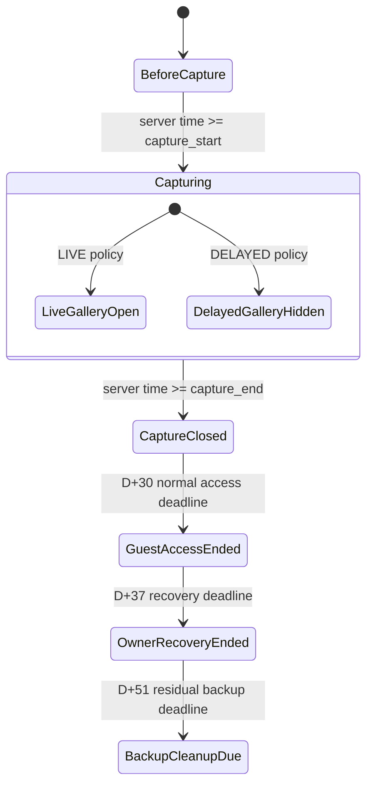
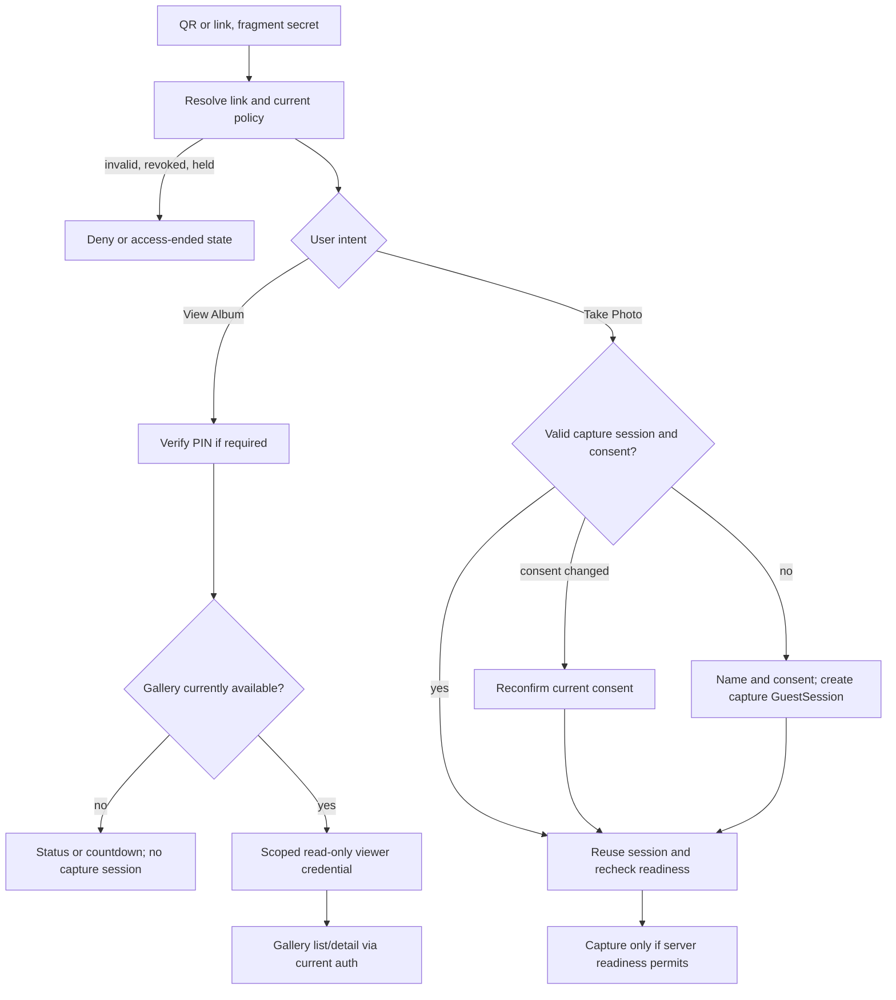
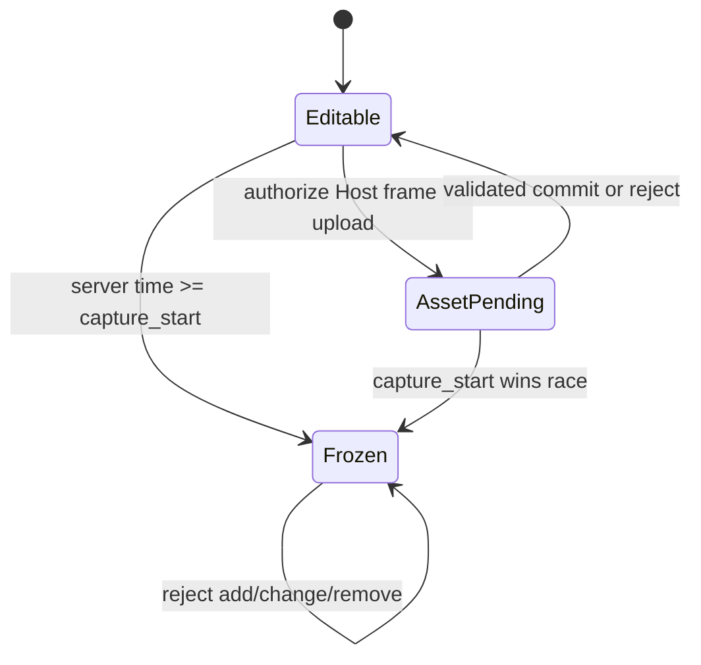
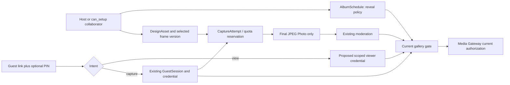

# Kepotret product and architecture contract v0.6 — integrated change addendum

**Status:** documentation and contract proposal only. Owner-approved PD-01–13 are locked product decisions; the architecture, API, data and security designs here remain technical proposals for independent review. Backend stays **ON HOLD**. No baseline document or runtime contract changes in this PR.

## Source baseline and evidence

Baseline: `main` at `1600e0d1a8d7101f6fad522208406f99a4ff7919` (23 October 2026, after PR #42). The external package was read in order: `01_OWNER_PRODUCT_DECISION_ADDENDUM.md`, `02_ARCHITECTURE_API_IMPACT_AND_DECISION_GATES.md`, `03_CODEX_CONTRACT_AUDIT_ENGINEERING_BRIEF.md`, then its `README.md`, under `Downloads/Kepotret_Product_Architecture_Contract_v0_6_2026-10-23/Kepotret_Product_Contract_v0_6/`.

Approved baseline documents inspected under `Downloads/SELF EMPLOYEE/DOKUMEN KEPOTRET/`: PRD v0.5 Final; BPMN & Use Case v0.5 Final; DFD & ERD v0.5 Final; Permission and Authorization Model v0.2 Final; System Architecture v0.3 Final; Physical Database Design v0.3 Final; API Contract v0.1 Final; and Technology and Provider Selection v0.2 Final. Repository evidence: [`contracts/openapi/Kepotret_OpenAPI_v1_Baseline.yaml`](../../../contracts/openapi/Kepotret_OpenAPI_v1_Baseline.yaml), [`contracts/openapi/README.md`](../../../contracts/openapi/README.md), generated client/types (read only), `src/features/guest/{components,capture}`, `src/features/host/{components,schedule-validation.ts}`, route catalog, and prior FE-UAT handoffs. The addendum supersedes older rules **only where it expressly says so**.

The original `1. Kepotret_Final_Frontend_Recheck_Seluruh_Halaman_2026-10-22.xlsx` workbook was inspected read only. Its `01 Final Recheck` sheet contains `UAT-FINAL-001` through `UAT-FINAL-102` (102 IDs). The updated Owner workbook, available locally as `2. Kepotret_Final_Owner_Recheck_V2_08_2026-10-23.xlsx`, adds `UAT-FINAL-103` through `UAT-FINAL-107` in its `01 Recheck 31` sheet: together these sources cover the 107 Owner audit IDs. The remediation request names a `(1).xlsx` copy, which was not present in the accessible Downloads tree; the available workbook contains all five specified rows and their Owner comments. Its `hasil_owner` and `status_engineering` cells are blank for those rows. The sheet title and historical `02 Approved 71` sheet do not establish approval for the five additions or final v0.6 frontend acceptance.

## Audit findings

| Severity | Finding | Evidence and disposition |
|---|---|---|
| **Critical** | A naive Live implementation could expose a committed but PENDING/HIDDEN/deleted photo, or serve a previously issued ticket after hold/revoke. | PRD BR-08/FR-12/FR-13, Permission §8, Architecture §10 and OpenAPI Guest Gallery/Media Gateway require current authorization. The proposed gate is per request and per media fetch; Gate E remains open. |
| **High** | Existing schedule schema only permits `{1,3,5,7}` and `RevealState` alone cannot express Live while capture is open. | OpenAPI `ScheduleWriteRequest`, `AlbumSchedule`, `RevealState`; Host schedule choice. Use explicit policy proposal; no `delay=0`. Gate A/G. |
| **High** | Current Gallery requires `/guest/me`, which returns a named capture `GuestSession`; anonymous read-only viewing would pollute guest counts or grant capture if modeled as that session. | OpenAPI `GuestContext`, `GuestSessionCreateRequest`, Gallery `GuestCookie`; PRD BR-25 and Permission §8. Distinct scoped principal proposal, Gate B/E. |
| **High** | A browser-composited JPEG plus claimed LUT/frame IDs does not prove the actual pixels include those effects. Server rendering changes the direct upload architecture and burst cost. | Current `capture-processor.ts`, direct R2 flow in Architecture v0.3. Gate D/F must resolve enforcement and transient raw handling. |
| **High** | Frame mutations must fail at the server clock boundary, including asset upload/commit and concurrent schedule edits; disabling a UI button is insufficient. | PD-11, current cover-only design API. Versioned design/freeze proposal and race tests, Gate C/G. |
| **Medium** | The cover contract permits MIME and a 5 MB maximum while the frontend checks type/size; required intrinsic 1920×1080 and true-alpha frame validation still need a server contract and byte-level policy. | `DesignAssetAuthorizeRequest` is `COVER` only; `design-setup.tsx` checks type/size. Gate F. |
| **Medium** | H69 hides camera switch when `enumerateDevices()` does not expose a second ID. | `guest-entry-surfaces.tsx:96`, `guest-entry-flow.tsx:658`; PD-13 overrides this. No backend endpoint required. |
| **Low** | The original final workbook ends at 102; five later Owner comments appear in the updated recheck with blank result/status cells. | Keep source versions distinct and do not infer approval from the new rows. |

## 1. Owner-approved product change matrix

**Status legend:** **OWNER APPROVED** means the addendum locks behavior. **TECHNICAL PROPOSAL** means this audit suggests a representation, not a contract change. **BLOCKED/UNVERIFIED** means a gate or evidence is still missing. H-numbers identify UI surfaces, not approval of frontend/backend completion.

| Product ID / status | Approved rule and affected page | Superseded or preserved baseline | Technical proposal and open gate |
|---|---|---|---|
| PD-01 **OWNER APPROVED** | Five choices: Live, D+1/3/5/7. H07, H29. | Supersedes PRD BR-06/FR-03 four-choice prohibition; BPMN-05 delayed-only reveal; OpenAPI schedule enum. | Explicit `LIVE`/`DELAYED` policy, no numeric zero. Gate A/G. |
| PD-02 **OWNER APPROVED** | New albums default D+1. H29. | Current Host `schedule-setup.tsx` initializes `1`, already aligned; preserve existing delayed albums. | Server default and omitted-field behavior must be specified. Gate A/G. |
| PD-03 **OWNER APPROVED** | Live can expose committed, moderation-eligible photos during the event; capture still ends at `capture_end`. H07/H29/H73. | Narrowly supersedes PRD BR-08/FR-12 “only after reveal” and BPMN-05. Preserves PRD FR-13 moderation, Permission §8, Gateway current authorization, hold. | Separate gallery availability from capture and per-photo eligibility. Gate A/E. |
| PD-04 **OWNER APPROVED** | Delayed reveal remains `capture_end + 1/3/5/7 days`; reveal changes neither shutter nor retention. H29. | Preserves delayed portion of PRD BR-06, five-minute authorized grace, D+30/D+37/D+51 lifecycle. | Derived `reveal_at` remains server owned. Gate A/G. |
| PD-05 **OWNER APPROVED** | “View Album” and “Take Photo” are separate; a valid returning capture session reuses name and still-valid consent. H64/H65. | Narrows current single guest-entry flow. Preserves PRD BR-01 name/consent **for capture**, existing session expiration and revocation. | Intent routing + capture-context revalidation; no duplicate GuestSession. Gate B. |
| PD-06 **OWNER APPROVED** | A new viewer may access available Gallery via link/QR and PIN if required, without name or capture session. H64/H65/H73. | Supersedes current Gallery dependence on `/guest/me`/`GuestCookie`; preserves link/PIN, reveal, moderation, hold, lifecycle. | Distinct read-only principal/credential, no presumed Like/share/download. Gate B/E. |
| PD-07 **OWNER APPROVED** | Viewer has no capture/upload/moderation rights and never enters participant count. H64/H65. | Preserves PRD BR-25 count by pre-end capture `GuestSession` IDs, duplicate names allowed. | No viewer row in `guest_sessions` or capture quota ledger. Gate B. |
| PD-08 **OWNER APPROVED** | Cover: 1920×1080, 16:9, JPEG/PNG/WebP. H58. | Extends current cover-only MIME/5 MB authorization with intrinsic geometry. Existing 5 MB limit is baseline **cover** limit, not frame limit. | Validate dimensions and actual decoded bytes client + server. Gate F. |
| PD-09 **OWNER APPROVED** | Optional Host PNG frame with real transparent area; portrait 1080×1440 and landscape 1440×1080 supported. H58. | Extends `COVER`-only design asset contract; no arbitrary guest upload. | Orientation asset IDs, byte cap and activation policy. Gate C/F. |
| PD-10 **OWNER APPROVED** | Host controls frame; Guest picks one system LUT preset per photo including Normal. H58/H69. | Supersedes PRD FR-02A/FR-08 Host-selected filter wording; preserves Host design ownership and camera-only capture. | Versioned preset identity and processing snapshot. Gate D. |
| PD-11 **OWNER APPROVED** | Frame configuration freezes at server `capture_start`; no add/change/remove then or later. H58. | Existing design API has no frame or freeze. Schedule/reschedule policy remains otherwise unchanged. | Guard authorize, commit and selection under server clock/revision. Gate C/G. |
| PD-12 **OWNER APPROVED** | Capture → LUT → overlay → JPEG compression → upload/commit → Gallery; only final JPEG ≤700000 bytes persists. H58/H69. | Preserves PRD BR-04/05, FR-09 reservation/idempotency and no device upload; extends current JPEG-only processor. | Compositor authority, profile snapshot, byte validation; no claim of visual proof from metadata. Gate D/F. |
| PD-13 **OWNER APPROVED** | Camera switch always visible, effective when supported, honest fallback; immersive fullscreen. H69. | Supersedes current conditional switch rendering; preserves camera permission/track cleanup. | Client capability/stream state only, no API change. Physical-device evidence required. |

### Existing invariants not changed

Guest names are non-unique and not credentials; capture uses browser camera only; no device-storage photo import; no shutter after event end; album start ≤3 calendar months from creation and duration ≤5 days; Free30 and maximum 10,000 photos; soft-deleted photos count against quota; upgrade/payment cutoff is `capture_end - 120 minutes`; no refunds; final guest count is by eligible `guest_session_id`; authorized upload grace ≤5 minutes; media current authorization and Operational Hold remain effective; normal guest access ends D+30, Owner recovery ends D+37, residual backup cleanup by D+51. Host/WO permissions and privileged Admin model remain unchanged. None of these are a proposal to reopen rules.

### Final recheck crosswalk and evidence limit

The original 102-item workbook, sheet `01 Final Recheck`, maps `UAT-FINAL-007`→H07 (copy), `029`→H29 (chips instead of dropdown), `058`→H58 (navigation and cover dimensions), `064`→H64, `065`→H65, `069`→H69 and `073`→H73. Its `catatan_owner` cells for 064/065/069/073 are empty; the v0.6 requirements come from PD-05–13 and the later Owner comments below, not from invented original comments. The updated recheck adds these five IDs. Their text is transcribed verbatim from `catatan_owner_recheck` (column I); `hasil_owner` (H) and `status_engineering` (K) are empty for each, so no approval or implementation status is assigned here.

| Updated ticket | Page / traceability | Scope |
|---|---|---|
| `UAT-FINAL-103` | H69 → PD-13 | Camera switching |
| `UAT-FINAL-104` | H69 → PD-10/PD-12 | System LUT choice and processing |
| `UAT-FINAL-105` | H58 → PD-09/PD-11/PD-12 | Transparent Host frame, freeze and final output |
| `UAT-FINAL-106` | H64/H65 → PD-05/PD-06/PD-07 | Gallery viewing without repeating capture entry |
| `UAT-FINAL-107` | H27 album overview (the workbook's page-code cell contains its route URL) | Separate frontend accordion follow-up; outside the v0.6 backend contract scope |

**UAT-FINAL-103 — original Owner comment:**

```text
Saya belum melihat button untuk switch kamera depan
```

**UAT-FINAL-104 — original Owner comment:**

```text
saya belum melihat button uintuk filter pada kamera. Saya sudah sampaikan di awal, bahwa perlu ada fitur filter LUT pada kamera. Pastinya ini berkaitan dengan backend, kamu catat dan siapkan buttonnya saja, agar bisa dilihat sementara di frontend
```

**UAT-FINAL-105 — original Owner comment:**

```text
Seingat saya, saya sudah sampaikan ini diawal. Saya ingin ada fitur setup frame juga pada foto, sampul album tetap diperlukan. Setup frame atau bingkai adalah host bisa mengatur atau menyiapkan frame/bingkai dalam format png (dengan transparant pada kotak tengah), yang mana nantinya setelah frame/bingkai ini diatur, para tamu/peserta setelah mereka melakukan foto pada kamera, hasil output/fotonya otomatis akan ada frame/bingkainya. Pastinya ini berkaitan dengan backend, kamu catat dan siapkan menu/card untuk setupnya saja, agar bisa dilihat sementara di frontend. Saya lampirkan refrensi gambarnya. berikan juga informasi size pixel untuk frame/bingkai, berapa kali berapa (px) untuk ukuran frame yang direkomendasikan oleh system.
```

**UAT-FINAL-106 — original Owner comment:**

```text
bagaimana user tamu/peserta dapat melihat album setelah akses url/scan qr? pastikan user tamu/album bisa dapat melihat album tanpa harus melewati proses photo atau open kamera atau mengisi form nama "lagi" terlebih dahulu.
```

**UAT-FINAL-107 — original Owner comment:**

```text
Pada halaman ringkasan album, untuk card Dokumentasi, Acara, Pengaturan, Pembayaran & Paket -> bagaimana jika dibuatkan card Collapse/Accordion (button-button dibawahnya baru bisa diklik setelah collapse/accordion dibuka), tujuannya agar pada halaman ini tidak terlalu padat dan card "draft album" tidak terlalu kebawah.
```

H07 is the Terms of Service page in the route catalog. PD-01/03 require accurate public explanation of reveal behavior there, but **do not** make its legal draft effective or waive separate legal approval. H27, H42, H58 cover guidance, footer WhatsApp, Guest ZIP, H80 server sort and H91 revoke MFA remain separate follow-ups or dependencies. The matrix does not reclassify those as v0.6 backend scope.

## 2. Flow and state proposal

**OWNER APPROVED:** PD-01–13 behavior. **TECHNICAL PROPOSAL:** the state names, credential model and sequence below. Existing backend and OpenAPI do not implement these flows. Each server decision uses current server time, current album/photo state and current authorization.

### Independent clocks and eligibility

`capture_start` opens capture, `capture_end` closes new shutter, and an already authorized attempt may finish only within the existing five-minute grace. **TECHNICAL PROPOSAL:** a `LIVE` gallery gate can open at `capture_start` while capture is still OPEN; a `DELAYED` gate opens at server-derived `capture_end + delayDays`. A gallery opened during Live does not imply a photo is visible: each photo must be committed, `PUBLISHED`, not deleted/purged, allowed by album visibility/lifecycle/access version, and not under Operational Hold. Gateway repeats authorization at byte fetch. Empty eligible gallery is valid. Host pre-reveal access retains its existing separate permission path.



The diagram represents independent capture and gallery conditions; the transition at `capture_end` does **not** close a Live Gallery by itself. In Delayed mode the gallery becomes available at its own derived reveal time, possibly after capture is closed. Operational Hold, revoked link/PIN/credential, moderation changes and lifecycle can deny access at any point. No scheduled job may publish media without rechecking this state.

### Guest entry: two user intents



**OWNER APPROVED:** viewers give no name, have no capture session and are excluded from `guest_count_final`; capture guests still meet name and consent rules. **TECHNICAL PROPOSAL:** viewer credentials have `GALLERY_READ` only initially; existing capture session cookie is never treated as a viewer upgrade and viewer credentials never satisfy `/capture-attempts`. A returning valid capture session bypasses repeated name/consent only while its consent version remains current. If consent changes, obtain new consent without creating a second participant row unless the current contract specifically requires session replacement; that detail is Gate B. Expired/rotated credentials are not silently renewed. A viewer selecting “Take Photo” must enter the capture flow and satisfy its own checks. If gallery is unavailable, show state/countdown without issuing a usable gallery credential; final response details depend on Gate B.

### Frame selection and freeze



**OWNER APPROVED:** frame selection freezes at `capture_start`, including an empty selection. **TECHNICAL PROPOSAL:** only Owner/active collaborator with existing `can_setup` may authorize, commit and select design assets before the boundary; server compares its clock and current schedule/revision atomically on every mutation. A pending upload finishing after the boundary cannot become an active frame. Cover behavior after event is a separate existing design policy; the new prohibition applies specifically to frame changes. Frame bytes are private and validated as real PNG with alpha and exact orientation dimensions. Whether activation requires both variants is Gate C; the frontend must not silently omit an active frame on one orientation. Each CaptureAttempt references an immutable effective frame/design revision. This snapshot timing is part of Gate D/G: if the frame freezes at event start, a reserved attempt must never observe a different active frame on retry.

### Photo processing and commit

```mermaid
flowchart LR
  Reserve[Pre-shutter reservation] --> Capture[Browser camera capture]
  Capture --> LUT[One system LUT incl Normal]
  LUT --> Frame[Active orientation frame overlay if any]
  Frame --> Compress[JPEG compression <=700000 bytes]
  Compress --> Authorize[Short private upload authorization]
  Authorize --> PUT[Upload final bytes]
  PUT --> Commit[Idempotent server commit and moderation state]
  Commit --> Gate[Current Gallery eligibility]
  Gate --> Media[Gateway checks again on fetch]
```



Retake releases the reservation once and needs a new attempt before another shutter. Processing error, offline status or unavailable frame/LUT asset must not create a committed Photo; release/expiry follows existing quota rules. Retry of a PUT/commit for one attempt must not produce two Photos. The final persisted object is JPEG only, ≤700000 bytes; no permanent raw, separate frame overlay at delivery, or guest device upload. `INSTANT` moderation may yield `PUBLISHED` after commit; `APPROVAL` yields `PENDING` until authorized approval. Live publication follows that existing distinction; Gate E must explicitly approve any finer transition rules. Browser-only rendering cannot prove pixels match declared effect IDs; Gate D resolves compositor authority before enforcement claims.

### Failure, race and expiration table

| Event | Required behavior / proposed handling |
|---|---|
| Offline before entry, PIN or pre-shutter attempt | Do not claim access/capture; show localized retry state, no local queued photo upload. |
| Offline after valid reservation or during PUT/commit | Preserve existing retry/expiry semantics and idempotency; do not start another attempt silently. Recover by server status, not local assumption. |
| `capture_end` races with shutter | Server reservation/readiness is authoritative; no new shutter at/after end. Pre-authorized attempt may finish within five-minute grace. |
| `capture_start` races with frame upload/selection | Server clock and optimistic revision decide atomically; a late mutation fails without changing active frame. |
| Hold, link rotation, PIN change, session revoke, or D+30 | Deny new viewer/capture actions and subsequent Gallery/Gateway fetches; previously downloaded bytes cannot be recalled. |
| Photo hide/delete while ticket exists | Next Gateway fetch denies; cached or saved client copies are outside recall. |
| Reveal job runs late/early, reschedule, old album | Derive from current policy/schedule; supersede stale job. Never infer Live from `delayDays=0`. |
| Camera switch permission/device failure or route exit | Keep switch visible with honest unavailable/busy message, stop old tracks, ignore stale requests, avoid stream leak. |
| Large or malformed image/frame | Reject decoded dimensions, true alpha/MIME/magic/byte limit as applicable, prevent decompression abuse; do not consume committed quota. |

All UI states require localized ID/EN copy and keyboard/screen-reader behavior. Physical iPhone Safari and Android Chrome verification remains **BLOCKED/UNVERIFIED** until real devices and backend implementation are available.

## 3. API contract proposal

**No path, field or example in this document is active unless explicitly labeled EXISTING.** The source OpenAPI is unchanged. **OWNER APPROVED** behavior is PD-01–13; all wire shapes below are **TECHNICAL PROPOSAL** pending gates A–G. API Contract v0.1 conventions remain: `/api/v1`, snake_case JSON, `{ "data": ... }` envelope, stable error codes, `Accept-Language` ID/EN, UTC timestamps with album timezone for calendar rules, server time authoritative, strict credentialed CORS, CSRF/Origin for cookie mutations, `X-Request-ID`, and UUIDv7 idempotency keys on relevant creates.

### Existing operations and proposed changes

| Surface | EXISTING OpenAPI v1 baseline | TECHNICAL PROPOSAL / gate |
|---|---|---|
| `GET/PUT /api/v1/albums/{album_id}/schedule` | `reveal_delay_days` required enum `1,3,5,7`; `reveal_at` server-derived; PUT has `expected_revision`, CSRF. | Represent Live vs Delayed explicitly in read/write, and keep `reveal_at` derived. Resolve compatibility and reschedule semantics at A/G. |
| `POST /api/v1/guest/access/resolve` | Link ID + secret, safe preview and `consent_version`, no guest cookie creation. | May add safe gallery gate/intent projection; must not leak PIN or private state. Link secret remains request body, never URL query/log. B. |
| `POST /api/v1/guest/sessions`, `GET /api/v1/guest/me` | Name + consent + optional PIN creates named GuestSession/GuestCredential; `/me` restores capture context. | Keep capture semantics. Reuse valid context; determine consent refresh and principal separation. B. |
| Guest Gallery list/detail | `GET /api/v1/guest/gallery/photos[/{photo_id}]`, `GuestCookie`, revealed visible photos; actions include Like, Download, Share. | Accept scoped viewer read principal as alternative, with current per-photo/Gateway authorization and explicit capability projection; viewer Like/Download/Share initially false pending E. B/E. |
| Guest Like/Download/Share | Existing endpoints use capture guest credential; Like keyed to `guest_session_id`. | Do not admit viewer to these endpoints without product/security decision and a non-GuestSession identity/abuse rule. E. |
| Design authorize/commit, `GET/PATCH /api/v1/albums/{album_id}/design` | Asset type `COVER`, JPEG/PNG/WebP, ≤5,000,000 bytes; selected cover + preview + setup revision. | Add typed portrait/landscape frame variants, true-alpha/dimension checks, revision/frozen projection and server freeze guard; frame byte cap unresolved. C/F/G. |
| Capture attempt, upload authorization, commit | Pre-shutter reservation, final JPEG ≤700000 bytes direct private PUT, idempotent commit; no processing metadata. | Bind effective LUT/frame profile snapshot to attempt/final; reject stale/invalid profile as designed; decide client vs server compositor. D/F. |
| Media Gateway and export | Short-lived media reference and current authorization; export carries final photo object bytes. | Evaluate Live reveal/current viewer scope on each fetch. Never overlay frame again. E. |
| Camera switch | Browser-only. | No API endpoint proposed. |

### Reveal policy: candidate shape (Gate A/G)

Proposed discriminated object for **new-version** schedule write/read:

```json
{ "reveal_policy": { "mode": "LIVE" } }
```

```json
{ "reveal_policy": { "mode": "DELAYED", "delay_days": 1 } }
```

Contract invariant: `LIVE` **must not** have `delay_days`; `DELAYED` must have exactly one of `1,3,5,7`. A draft new album defaults to `DELAYED/1` when no explicit choice was made; whether omission is accepted over the API is an open Gate A detail. Read projections should include `capture_state`, server-derived `reveal_at` (including its exact Live meaning after review), and a separate `gallery_access_state` or equivalent so `OPEN capture + available Gallery` is representable. `RevealState` HIDDEN/REVEALED alone and delay `0` cannot safely carry this policy. PUT retains `expected_revision`, current Host/`can_setup` authorization, CSRF/Origin, server time and schedule-version checks. Suggested errors: `400/422` invalid union, `401/403/404` actor/object, `409` stale revision or forbidden state, `429` rate, `503` dependency. Error codes and response shapes require OpenAPI review; these are not new deployed codes.

Compatibility must be deliberate: old delayed albums map to `DELAYED` with the same delay and historical `reveal_at`; old clients that expect required numeric `reveal_delay_days` cannot parse Live. Gate G must choose a versioned response/feature-negotiation or coordinated cutover with an explicit minimum client. Do not silently return `0`, `null` in a required integer, or omit a required field in the existing schema.

### Viewer access: candidate exchange and scopes (Gate B/E)

**New operation proposal, not an existing endpoint:** `POST /api/v1/guest/viewer-access` (name/path to be chosen in OpenAPI review). Candidate body `{ "link_id": "<uuid>", "access_secret": "<opaque>", "pin": "<value-or-null>" }`; successful response gives only a safe gallery/event state projection in `{ "data": ... }`, while server issues an opaque, short-lived, Secure HttpOnly SameSite viewer credential. A separate `GET /api/v1/guest/viewer-context` is one option; alternatively extend an existing safe context route with a principal discriminator. The viewer credential must be isolated from the capture `GuestCookie` and cannot authorize `/guest/me`, capture readiness/attempt, upload or moderation. The chosen cookie/path/site topology and CSRF model need review against the current API/Media Gateway origins. Origin/rate limiting and PIN throttling apply to exchange; later cookie mutations retain CSRF. Link/PIN rotation and `access_version`, TTL, hold and D+30 close invalidate it server-side. No name, `guest_session_id`, quota allocation, or participant count record is created.

For list/detail, propose a server-derived principal kind `CAPTURE_GUEST` or `VIEWER_READ` and permission-filtered `actions` fields. Viewer `can_like`, `can_download`, `can_share` are false **until Gate E decides otherwise**; even if a stale frontend exposes a button, the corresponding endpoint must deny. Existing Like uniqueness `(photo_id, guest_session_id)` cannot identify an anonymous viewer. A gallery-open preview must not promise that individual photos exist. Unauthorized requests should use the existing 401/403/404/410 distinctions without disclosing hidden albums; Gate B specifies exactly which expired/revoked cases are 401 vs 403 vs 410. `429` includes `Retry-After`; `503` is transient. No automatic privilege upgrade on a cookie collision.

### Design and processing: candidate payloads (Gates C/D/F/G)

Extend existing design upload authorization rather than treating a frame as a cover. Candidate `asset_type` values `COVER`, `FRAME_PORTRAIT`, `FRAME_LANDSCAPE` are **names for review**. The server verifies actual decoded format, geometry and alpha, not just a claimed MIME/extension. Cover: 1920×1080 JPEG/PNG/WebP; existing cover byte cap 5,000,000 until changed by an approved contract. Frame: PNG, actual transparent area, portrait 1080×1440 or landscape 1440×1080; maximum input bytes **BLOCKED/UNVERIFIED** (Gate F). A candidate design projection adds selected IDs, revision and frame-frozen state. A PATCH candidate uses existing `expected_revision` and selects committed assets belonging to the same album. Reject frame authorize/commit/selection at `server_time >= capture_start` with a documented conflict code and no side effects; cover policy remains separate. Gate C decides whether both orientations are required to activate a frame. Do not accept the frame as a user-provided URL or return private storage coordinates.

Candidate capture reservation/read projection includes `processing_profile` (effective system LUT preset ID/version, active frame asset/version for orientation, profile revision). The profile is server-issued and bound to the attempt; the browser cannot self-authorize a frame ID. Candidate final upload authorization/commit validates JPEG magic/MIME and `size_bytes <= 700000`, single object/attempt, current guest/album state, profile consistency, checksum/bytes and idempotent result. Existing PUT remains private direct upload **only if Gate D chooses browser composition**. The server can validate bytes and metadata but cannot prove visual LUT/frame pixels from IDs or hash alone. If Gate D requires canonical server composition, a separate transient ingest/processing contract and retention/security design must be approved before any OpenAPI change; raw permanence remains prohibited. No raw object may be treated as a committed Photo.

### Response/error examples for review

The examples show envelope conventions and are **not** generated types or approved error codes:

```json
{ "data": { "reveal_policy": { "mode": "DELAYED", "delay_days": 3 }, "reveal_at": "2026-11-06T09:00:00Z", "gallery_access_state": "HIDDEN" } }
```

```json
{ "error": { "code": "FRAME_FROZEN", "message": "Bingkai tidak dapat diubah setelah acara dimulai.", "request_id": "<uuid>", "details": null } }
```

Candidate status mapping: `400` malformed union/JSON; `401` absent/expired credential; `403` known actor denied, hold or closed scope where disclosure is safe; `404` nonexistent or intentionally concealed object; `409` stale revision, freeze race or attempt state; `410` normal guest lifecycle expiry per current `/guest/me` precedent; `422` decoded asset/geometry/alpha/profile invalid; `429` PIN/entry rate limit; `500/503` server/dependency failure. Stable machine codes and privacy-preserving choice among 401/403/404/410 must be finalized in Gate B/F, localized text handled by frontend. No automatic second capture or export job is implied by retries.

### Review sequence

Resolve A–G and review this integrated addendum against PRD/BPMN/DFD/ERD/Permission/Physical DB and API Contract v0.1. Any separately authorized future OpenAPI evolution must start with a reviewed source diff before generated clients and contract, migration, authorization and compatibility tests from Section 6. Until then, every baseline document and the existing v1 OpenAPI/generated clients remain authoritative for running code and unchanged by this PR.

## 4. Data impact and migration strategy

**TECHNICAL PROPOSAL, not a migration.** The approved Physical Database v0.3 describes 42 V1 tables; none is changed by this PR. The proposed data structures below require architecture, privacy and API review. **OWNER APPROVED** invariants are cited separately.

### Baseline data flow and proposed boundary

Existing flow: Guest link/PIN → named `GuestSession`/`GuestCredential`/`GuestConsent` → `CaptureAttempt` and album/guest quota reservation → direct private final JPEG PUT → idempotent `Photo` commit → moderation/reveal gate → short Media Gateway reference → current authorization → private bytes. `AlbumSchedule` controls capture and delayed reveal. `DesignAsset` currently supports cover. `Album.access_version` invalidates guest access after rotation. `AlbumLifecycle`, purge and backup cleanup run relative to `capture_end`.



### Entity/constraint impact

| Existing entity | Proposed change or invariant | Constraints and decision |
|---|---|---|
| `albums`, `album_schedules` | Store/derive explicit Live vs Delayed policy; D+1 default for new album; preserve historical delay and `reveal_at`. Capture, payment cutoff, first-confirmed schedule and lifecycle clocks stay independent. | Existing schedule `reveal_delay_days IN (1,3,5,7)` cannot encode Live. Choose nullable delay + mode/check or equivalent without invalid combinations; Gate A/G. `schedule_version`/`setup_revision` and stale job suppression remain. |
| `guest_sessions`, `guest_credentials`, `guest_consents` | Continue to represent **capture participants** only, named and consented. Reuse valid session; viewer must not create one. | Preserve `guest_count_final` from qualifying pre-end GuestSession IDs, duplicate names, per-session quota and cleanup/FKs. Gate B defines consent refresh behavior. |
| New viewer credential entity **or** scoped extension | Candidate ephemeral `viewer_access` record/opaque credential with album/link relation, hashed token, expiry, access_version and revocation scope; no display name or capture quota. | Exact table vs stateless signed token is Gate B. Any persistent FK should reference album/link safely, never imply `GuestSession` or `PhotoLike` participant. Bound token lifetime and cleanup; no raw secret in logs. |
| `design_assets` / album design selection | Cover stays JPEG/PNG/WebP, 1920×1080. Add typed portrait/landscape PNG frame assets, validated decoded geometry/alpha, selected immutable version and freeze point. | Asset belongs to same album; only committed validated asset selectable; no frame mutation at/after server `capture_start`, including pending upload commit. Frame input byte cap and both-orientation activation are Gates C/F. Cover existing ≤5 MB is not inherited by frame. |
| `capture_attempts`, `photos` | Bind effective preset/version and frame/design revision to attempt and final Photo; final JPEG remains one immutable private object ≤700000 bytes. | Existing album/guest composite ownership and unique attempt→Photo relationship remain. Processing metadata must not substitute for proof of actual pixels; Gate D decides trusted compositor. No second overlay on delivery/export. |
| `photo_likes` | Existing uniqueness uses `(photo_id, guest_session_id)`. | Viewer gets no Like by default; any change requires identity/abuse design and Gate E. Do not insert fake GuestSession rows. |
| `album_lifecycle`, jobs, export, audit | Keep capture-end-based D+30 normal access/D+37 Owner recovery/D+51 backup cleanup, export revisions and hold. Live reveal jobs are unnecessary for opening state if computed; delayed jobs must recheck schedule. | Audit schedule/frame decisions and denied mutation without secrets/raw photo. Final exported JPEG bytes contain the effect once. No retention extension. |

Conceptual relationships: `Album 1—1 current AlbumSchedule`, `Album 1—N AlbumScheduleHistory`, `Album 1—N DesignAsset`, `Album 1—N GuestSession`, proposed `Album 1—N ViewerCredential` (if stateful), `GuestSession 1—N CaptureAttempt`, `CaptureAttempt 1—0..1 Photo`, `Photo 0..N PhotoLike`. Viewer must not be linked as a photo author; photo authors remain capture GuestSessions. Cross-album IDs and object keys must be validated, with restrictive deletion rather than accidental cascade of audit/history. Exact keys/indexes/DDL are Gate G and a separate reviewed migration PR.

### Storage, privacy, quota and authorization

**OWNER APPROVED:** raw images are never persisted as album photos; only final JPEG ≤700000 bytes is persisted. Direct upload to private storage and current Media Gateway authorization remain baseline. If a server compositor is selected, Gate F must define tightly bounded transient raw storage/memory, access, cleanup after failures and backup exclusion; it cannot simply add a permanent raw media bucket. Frame assets are private design inputs, not public browser URLs or accepted from guest-supplied paths. Decoding must limit dimensions, memory and byte size; server verifies alpha and actual type. Signed upload authorization alone does not validate content.

Reservations precede shutter and count against album and capture-session availability; only committed final Photos increment committed count. Retake/release/expiry free reservation once. Soft-deleted Photos remain in quota until existing purge logic. Viewer reads do not reserve quota or increment guest count. Existing 500 starts/sec target and 10,000-photo album bound apply to indexes, Gateway checks, rendering choice, and cleanup. No expanded payment, upgrade or refund semantics are proposed.

### Migration and release plan for review (Gate G)

1. **Inventory and backup:** measure existing schedules, null/invalid data, confirmed snapshots, long-lived sessions and delayed jobs. Record baseline counts/checksums. No migration runs while backend is on hold.
2. **Expand schema only after approval:** add versioned policy/storage fields or new viewer store without removing delayed columns. Backfill existing albums to `DELAYED` with their existing `1/3/5/7` value; verify `reveal_at` stays byte-for-byte/instant-equivalent, not recomputed across timezone changes. Do not convert any old album to Live.
3. **Dual-read and guarded write:** backend can read old delayed rows and new policy; old clients remain delayed-only while compatibility strategy is active. New Live writes are gated until all readers, Gateway, jobs and frontend understand them. Audit and reject invalid union/state combinations.
4. **Reconcile derived jobs and permissions:** supersede stale reveal jobs on schedule changes; Gateway and Guest Gallery use the same current policy and access version. Viewer credential rollout uses independent scope and revocation. Frame mutations use server clock/freeze in a single transaction; any unfinished asset staging is cleaned according to reviewed lifecycle.
5. **Canary and rollback:** enable for controlled new albums after contract tests and monitoring. Roll back traffic/feature flag if exposure or count mismatch occurs; retain data columns and Live rows until a safe downgrade/reconciliation plan exists. Blindly casting Live to D+1 or `0` is forbidden. Destructive contract/drop migration is a later separately reviewed step.

Migration must be rehearsed on representative delayed albums, boundary timezones, 10,000-photo data and concurrent writes. Backups, restore timing, release ordering (API → Gateway/workers → frontend or negotiated equivalent), monitoring and the point where old clients stop being supported require explicit architecture sign-off. This document contains no executable SQL or migration.

## 5. Security risks and decision gates

The Owner has already approved PD-01–13. The gates below concern **implementation choices**, not a request to re-approve those product outcomes. **BLOCKED/UNVERIFIED** means no backend contract or implementation may claim the associated behavior yet. P0 is privacy/data correctness or contract-blocking; P1 is important interoperability, reliability or UX.

| Gate / priority | Question and recommendation (**TECHNICAL PROPOSAL**) | Decision owner and evidence required | Status |
|---|---|---|---|
| A / **P0** | Choose explicit `LIVE` vs `DELAYED(1/3/5/7)` JSON and separate gallery availability; reject `delay=0`. Define `reveal_at` in Live, omission/default and 409/422. | Architecture + API review of schedule schema, state projections, old-client compatibility and PRD/BPMN diff. | **OPEN** |
| B / **P0** | Define distinct viewer credential/scope, cookie topology, TTL, rotation/PIN invalidation, CSRF and safe context. Recommend read-only scoped principal, no GuestSession. | Security + architecture review; threat model, cross-origin cookie test, count/consent tests, 401/403/404/410 privacy contract. | **OPEN** |
| C / **P1** | Decide whether enabling a frame requires both portrait and landscape variants. Recommend both to avoid inconsistent orientation output; define missing-asset fallback explicitly. | Product/UX confirmation + API/design review; both device orientations. PD-09 itself is already approved. | **OPEN** |
| D / **P0** | Decide browser-composited final JPEG vs canonical server composition, strict visual enforcement, snapshot timing and burst budget. Browser option fits existing direct PUT but metadata cannot prove pixels. Server option enforces output but adds transient processing and cost. | Owner + Engineering architecture ADR, adversarial pixel test, mobile perf, 500 starts/sec load and storage/retention design. | **OPEN** |
| E / **P0** | Specify Live eligibility under INSTANT/APPROVAL and exact viewer Like/share/download rights. Recommend only committed `PUBLISHED` photos and initial `GALLERY_READ` viewer scope; no invented viewer Like identity. | Product + Security; permission matrix and Gateway concurrency/revocation tests. | **OPEN** |
| F / **P0** | Set frame PNG input byte cap, decoded-pixel/alpha limits and any transient raw retention/security constraints. Existing 5 MB cover and 700000-byte final JPEG limits are distinct. | Security + architecture; decompression tests, storage lifecycle and vendor/provider limits. | **OPEN** |
| G / **P0** | Define migration, old-client negotiation/versioning, Live rollback, derived job/read consistency and frame/schedule revisions. Preserve all delayed album instants. | Architecture/API/data review; rehearsed migration and rollback with old clients and historical albums. | **OPEN** |

### Risks and controls

| Risk | Severity | Control / unresolved evidence |
|---|---|---|
| Live exposes PENDING/HIDDEN/deleted photo or stale ticket after hold/revoke | **Critical** | Shared server eligibility predicate at list/detail/Gateway, current moderation/access version per fetch; tests T-08–T-11. Gate E. |
| Viewer credential gains capture rights or increments `guest_count_final` | **Critical** | Separate principal namespace, deny capture APIs by server scope, no GuestSession row; tests T-04–T-07. Gate B. |
| Browser sends a correctly labeled but unframed/unfiltered JPEG | **High** | Do not assert server pixel verification for browser pipeline; Gate D ADR must choose acceptable trust or server compositor. |
| Frame changes after `capture_start` through authorize/commit/race | **High** | Server-clock transactional freeze on every mutating entry point, immutable version/snapshot; T-16–T-18. Gate C/G. |
| Existing delayed albums misread as Live or reveal at shifted time | **High** | Explicit backfill, historical instant preservation, old-client plan and rollback; T-21–T-23. Gate A/G. |
| Crafted cover/frame decompression or disguised PNG | **High** | Magic/decode/geometry/alpha/byte checks, bounded decode, private staging cleanup; T-14–T-15. Gate F. |
| 500 upload starts/sec collapses if server processing added | **High** | Benchmark hot album quota lock, CPU/memory, storage and gateway; avoid declaring target met from local E2E. Gate D/F. |
| Anonymous viewer Like/share/download identity or leakage unspecified | **High** | Initial read-only recommendation, explicit action caps and denial; product/security decision Gate E. |
| Camera switch hidden on permission-limited devices or leaves stream running | **Medium** | Always-visible UI, capability/fallback state and real-device lifecycle tests T-24–T-25. |
| Legal H06/H07 or separate UAT issues treated as approved by this audit | **Medium** | Keep legal content draft/unapproved, track H27/H42/footer/Guest ZIP/H80/H91 separately. |

### Architecture ADR needed for Gate D

| Option | Data path | Benefits | Material cost/risk |
|---|---|---|---|
| Browser compositor | Client captures, applies versioned LUT/frame, compresses final JPEG, private direct PUT; server verifies bytes/type/size, snapshot IDs, checksum and commit. | Matches existing direct-to-storage design; immediate preview and less server CPU. | Metadata and hash cannot prove pixels carry the LUT/frame. Browser canvas/device variance and tampering need explicit trust acceptance. |
| Server compositor | Client sends transient capture input through reviewed bounded ingest; server applies canonical LUT/frame and writes only final ≤700000-byte JPEG as Photo. | Enforces canonical output if implemented and verified. | Transient raw handling, privacy, resource use, burst latency/cost, retry/idempotency and new API/storage path; no raw permanent backup. |

An optional hybrid verifier is not assumed to solve pixel proof without a specified algorithm and measured false results. The ADR must state trust boundary, definition of “final only persisted,” transient cleanup, preview parity, and failure/retry semantics. No implementation choice is locked here.

### Review exit criteria

Record signed decisions for A–G and any new product ambiguity; align PRD/BPMN/DFD/ERD/Physical DB/Permission/API Contract; review a source OpenAPI diff and compatibility rollout; approve the test matrix and privacy threat model. Then, in a separate authorized implementation, regenerate clients and run backend/frontend/integration/device/load tests. Backend remains **ON HOLD** until separately released. This documentation PR stops before merge for independent architecture review.

## 6. Test contract matrix

These are **future implementation tests**, not tests executed by this documentation PR. **OWNER APPROVED** outcomes trace to PD-01–13; assertions that depend on a schema, cookie or compositor choice are **TECHNICAL PROPOSAL** until Gates A–G close. Use source OpenAPI contract tests, unit/state tests, backend integration, browser E2E without retries, Gateway/security tests, physical devices and performance evidence. Synthetic UAT fixtures cannot establish real backend or camera compliance.

| ID | Level / trace | Scenario and acceptance condition | Gate |
|---|---|---|---|
| T-01 | Contract + Host UI, PD-01/PD-02, H07/H29 | New album presents exactly Live + D+1/3/5/7, defaults D+1; malformed Live+delay and delay `0` rejected; ID/EN copy matches policy. | A |
| T-02 | Integration, PD-03/PD-04 | Live Gallery can open during capture while shutter closes at `capture_end`; delayed Gallery remains hidden until `capture_end + n` in album timezone; reveal never extends D+30/D+37/D+51. | A/G |
| T-03 | Time/race, PD-03/04 | At exact capture end new reservation fails; prior authorized attempt can finish within existing five-minute grace, and only eligible committed photo becomes Live-visible. Stale reveal job cannot open wrong album/version. | A/G |
| T-04 | API/E2E, PD-05–07, H64/H65 | Valid returning capture session restores without repeating unchanged name/consent or creating another GuestSession. Changed consent needs reconfirmation; expired/revoked access denied. | B |
| T-05 | API/E2E, PD-06/PD-07 | New viewer uses valid QR/link and PIN if required to view available Gallery with no name, capture session, quota reservation or count increment. Before reveal sees only safe status/countdown. | B |
| T-06 | Security, PD-06/PD-07 | Viewer cookie/principal cannot call `/guest/me`, capture-readiness as capture permission, reserve/upload/commit, moderation or Owner routes. A forged client role/scope does not help. | B/E |
| T-07 | Security/count, PD-06/PD-07 | Link/PIN rotation, access-version bump, TTL, hold and D+30 invalidate viewer and capture fetches; `guest_count_final` equals qualifying capture GuestSession IDs, not viewers or distinct names. | B/G |
| T-08 | Contract/Gateway, PD-03 | Live with INSTANT moderation shows Photo only after valid commit and PUBLISHED; APPROVAL leaves PENDING invisible until authorized approval; HIDDEN/deleted/purged never visible. | E |
| T-09 | Gateway race, PD-03 | Previously issued media ticket fails on next fetch after hide/delete/revoke/hold/access expiry; list/detail and media use same album/photo predicate. | E |
| T-10 | Security, PD-03/06 | IDOR across albums/photos, forged cursor/context, and access from unauthorized viewer do not reveal metadata or bytes; 401/403/404/410 match reviewed privacy contract. | B/E |
| T-11 | Permission/actions, PD-06 | Viewer Like/share/download attempts denied under initial read-only proposal; capture guest actions still obey existing flags and unique Like rule. Re-test if Gate E approves more capabilities. | E |
| T-12 | Contract, PD-08, H58 | Cover JPEG/PNG/WebP at 1920×1080 accepted within existing cover byte cap; wrong dimensions/type/oversize/truncated payload rejected; frontend guidance agrees. | F |
| T-13 | Contract, PD-09/10, H58 | Exact portrait 1080×1440 and landscape 1440×1080 true-alpha PNG accepted as frame; fake extension, opaque PNG and wrong orientation rejected. Activation with one variant follows Gate C decision. | C/F |
| T-14 | Security asset, PD-08/09 | Magic bytes, decoded dimensions, true alpha and byte limit rechecked server-side after upload; decompression bomb/oversized metadata rejected with private staging cleanup. | F |
| T-15 | Authorization asset, PD-09/11 | Only Owner/active `can_setup` collaborator for same album can authorize/commit/select frame; cross-album asset IDs and revoked collaborator fail. Cover permission preserved. | C/G |
| T-16 | Boundary race, PD-11 | At server time exactly `capture_start`, frame add/change/remove, late upload commit and concurrent PATCH all fail without altering selection; stale revision fails. | C/G |
| T-17 | Schedule/version, PD-11 | Permitted pre-event reschedule and first-confirmed rules leave deterministic freeze boundary; pending attempt keeps a stable effective frame version through retry. | D/G |
| T-18 | Unit/browser, PD-10/12, H69 | Guest can choose one system LUT per shot including Normal; preview and final JPEG show LUT then frame overlay, orientation/crop correct; no second overlay in Gallery/ZIP. | D |
| T-19 | API/storage, PD-12 | Persist exactly one final JPEG per committed Photo, ≤700000 bytes, valid magic/MIME, no EXIF/location leak or permanent raw; process failure does not commit. Test 700000/700001 boundary. | D/F |
| T-20 | Reservation/offline, PD-12 | Offline before shutter cannot reserve; retake/release/expiry returns quota once; retry PUT/commit with same attempt is idempotent and does not create duplicate Photo or new job. | D |
| T-21 | Migration, PD-01/04 | All existing albums backfill as DELAYED with unchanged delay, UTC `reveal_at`, capture/retention/payment deadlines and historical jobs. None becomes Live by default. | A/G |
| T-22 | Client compatibility | Old generated client/schedule consumer behavior is explicitly tested against negotiated response/version, including Live rows, without interpreting `0` or invalid null. | G |
| T-23 | Rollback/recovery | Rollout can stop Live writes, preserve Live data safely, restore old delayed reads, supersede stale jobs, and verify counts/instants against backup. | G |
| T-24 | Browser/device, PD-13, H69 | Switch control visible before/after permission and with one camera; enabled when switch is supported; honest localized unavailable/busy/denied states. Fullscreen remains without header/footer/preferences. | — |
| T-25 | Physical iPhone Safari + Android Chrome, PD-12/13 | Front/back switching, permission denial, viewport safe areas, stream cleanup on exit, portrait/landscape frame parity and 700000-byte processing on slow device. Synthetic browsers do not satisfy this. | D |
| T-26 | Load/soak, PRD NFR-04 | Burst **500 uploads starting within one second** on hot album; measure success, p95/p99 reservation/commit/Gateway latency, quota lock contention, CPU/memory, queue, storage and cost; include 2,000 guests and 10,000-photo album. Do not claim pass before measured target and thresholds are reviewed. | D/F/G |
| T-27 | Regression, unchanged rules | Free30/max10000, payment cutoff `capture_end-120m`, no refund, soft-delete quota, D+30/D+37/D+51, Owner recovery, collaborator permission, Admin hold/MFA, export revision/ZIP, no device photo import remain unchanged. | G |
| T-28 | Documentation/content | PRD/BPMN/DFD/ERD/Permission/API Contract/OpenAPI/generated client, Host and Guest ID/EN copy all agree after sign-off; H06/H07 legal remain draft until separate approval. | A–G |

### Validation for this documentation PR

Check this single addendum contains the product matrix, flows, API, data, risk and test sections; every PD-01–13 is represented in the product matrix and linked to a test; gates A–G appear in risk/API/data/flows; markdown links resolve; `git diff --check` is clean; `pnpm api:check` finds no drift. There is no value in running camera, database or backend tests for unchanged runtime. A docs-only PR cannot satisfy T-01–T-28; these become acceptance criteria for a later approved implementation.

## 7. Review handoff

For a future, separately authorized implementation, the reconciliation targets are PRD BR-06/08/25 and FR-02A/03/06/08/12/13; BPMN guest entry, capture, reveal and moderation; DFD/ERD and Physical Database; Permission Model; API Contract v0.1; source OpenAPI before generated clients; frontend H07/H29/H58/H64/H65/H69/H73 and related setup/review/reschedule/gallery states; and ID/EN help and marketing copy that states four delayed choices. **This PR leaves every locked baseline document unchanged.** H06/H07 legal text remains draft and needs separate legal approval. Existing media Gateway, quota, payment and retention rules remain in force.

This PR changes only this addendum. No service, migration, OpenAPI source, generated client, environment, authentication, or runtime behavior changes are made. Reviewer should resolve gates A–G in Section 5 before an implementation contract is approved. See the PR checks for validation and exact reviewed HEAD; **stop before merge for independent architecture review**.
