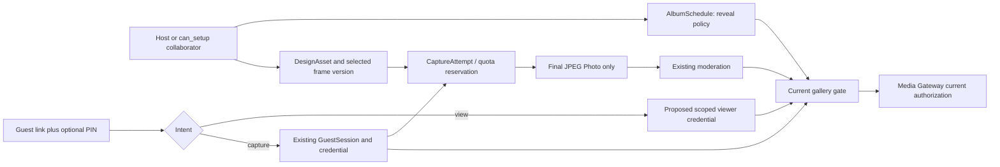

# Conceptual DFD/ERD and migration impact

**TECHNICAL PROPOSAL, not a migration.** The approved Physical Database v0.3 describes 42 V1 tables; none is changed by this PR. The proposed data structures below require architecture, privacy and API review. **OWNER APPROVED** invariants are cited separately.

## Baseline data flow and proposed boundary

Existing flow: Guest link/PIN → named `GuestSession`/`GuestCredential`/`GuestConsent` → `CaptureAttempt` and album/guest quota reservation → direct private final JPEG PUT → idempotent `Photo` commit → moderation/reveal gate → short Media Gateway reference → current authorization → private bytes. `AlbumSchedule` controls capture and delayed reveal. `DesignAsset` currently supports cover. `Album.access_version` invalidates guest access after rotation. `AlbumLifecycle`, purge and backup cleanup run relative to `capture_end`.

## Entity/constraint impact

| Existing entity | Proposed change or invariant | Constraints and decision |
|---|---|---|
| `albums`, `album_schedules` | Store/derive explicit Live vs Delayed policy; D+1 default for new album; preserve historical delay and `reveal_at`. Capture, payment cutoff, first-confirmed schedule and lifecycle clocks stay independent. | Existing schedule `reveal_delay_days IN (1,3,5,7)` cannot encode Live. Choose nullable delay + mode/check or equivalent without invalid combinations; Gate A/G. `schedule_version`/`setup_revision` and stale job suppression remain. |
| `guest_sessions`, `guest_credentials`, `guest_consents` | Continue to represent **capture participants** only, named and consented. Reuse valid session; viewer must not create one. | Preserve `guest_count_final` from qualifying pre-end GuestSession IDs, duplicate names, per-session quota and cleanup/FKs. Gate B defines consent refresh behavior. |
| New viewer credential entity **or** scoped extension | Candidate ephemeral `viewer_access` record/opaque credential with album/link relation, hashed token, expiry, access_version and revocation scope; no display name or capture quota. | Exact table vs stateless signed token is Gate B. Any persistent FK should reference album/link safely, never imply `GuestSession` or `PhotoLike` participant. Bound token lifetime and cleanup; no raw secret in logs. |
| `design_assets` / album design selection | Cover stays JPEG/PNG/WebP, 1920×1080. Add typed portrait/landscape PNG frame assets, validated decoded geometry/alpha, selected immutable version and freeze point. | Asset belongs to same album; only committed validated asset selectable; no frame mutation at/after server `capture_start`, including pending upload commit. Frame input byte cap and both-orientation activation are Gates C/F. Cover existing ≤5 MB is not inherited by frame. |
| `capture_attempts`, `photos` | Bind effective preset/version and frame/design revision to attempt and final Photo; final JPEG remains one immutable private object ≤700000 bytes. | Existing album/guest composite ownership and unique attempt→Photo relationship remain. Processing metadata must not substitute for proof of actual pixels; Gate D decides trusted compositor. No second overlay on delivery/export. |
| `photo_likes` | Existing uniqueness uses `(photo_id, guest_session_id)`. | Viewer gets no Like by default; any change requires identity/abuse design and Gate E. Do not insert fake GuestSession rows. |
| `album_lifecycle`, jobs, export, audit | Keep capture-end-based D+30 normal access/D+37 Owner recovery/D+51 backup cleanup, export revisions and hold. Live reveal jobs are unnecessary for opening state if computed; delayed jobs must recheck schedule. | Audit schedule/frame decisions and denied mutation without secrets/raw photo. Final exported JPEG bytes contain the effect once. No retention extension. |

Conceptual relationships: `Album 1—N AlbumSchedule versions`, `Album 1—N DesignAsset`, `Album 1—N GuestSession`, proposed `Album 1—N ViewerCredential` (if stateful), `GuestSession 1—N CaptureAttempt`, `CaptureAttempt 0..1—1 Photo`, `Photo 0..N PhotoLike`. Viewer must not be linked as a photo author; photo authors remain capture GuestSessions. Cross-album IDs and object keys must be validated, with restrictive deletion rather than accidental cascade of audit/history. Exact keys/indexes/DDL are Gate G and a separate reviewed migration PR.

## Storage, privacy, quota and authorization

**OWNER APPROVED:** raw images are never persisted as album photos; only final JPEG ≤700000 bytes is persisted. Direct upload to private storage and current Media Gateway authorization remain baseline. If a server compositor is selected, Gate F must define tightly bounded transient raw storage/memory, access, cleanup after failures and backup exclusion; it cannot simply add a permanent raw media bucket. Frame assets are private design inputs, not public browser URLs or accepted from guest-supplied paths. Decoding must limit dimensions, memory and byte size; server verifies alpha and actual type. Signed upload authorization alone does not validate content.

Reservations precede shutter and count against album and capture-session availability; only committed final Photos increment committed count. Retake/release/expiry free reservation once. Soft-deleted Photos remain in quota until existing purge logic. Viewer reads do not reserve quota or increment guest count. Existing 500 starts/sec target and 10,000-photo album bound apply to indexes, Gateway checks, rendering choice, and cleanup. No expanded payment, upgrade or refund semantics are proposed.

## Migration and release plan for review (Gate G)

1. **Inventory and backup:** measure existing schedules, null/invalid data, confirmed snapshots, long-lived sessions and delayed jobs. Record baseline counts/checksums. No migration runs while backend is on hold.
2. **Expand schema only after approval:** add versioned policy/storage fields or new viewer store without removing delayed columns. Backfill existing albums to `DELAYED` with their existing `1/3/5/7` value; verify `reveal_at` stays byte-for-byte/instant-equivalent, not recomputed across timezone changes. Do not convert any old album to Live.
3. **Dual-read and guarded write:** backend can read old delayed rows and new policy; old clients remain delayed-only while compatibility strategy is active. New Live writes are gated until all readers, Gateway, jobs and frontend understand them. Audit and reject invalid union/state combinations.
4. **Reconcile derived jobs and permissions:** supersede stale reveal jobs on schedule changes; Gateway and Guest Gallery use the same current policy and access version. Viewer credential rollout uses independent scope and revocation. Frame mutations use server clock/freeze in a single transaction; any unfinished asset staging is cleaned according to reviewed lifecycle.
5. **Canary and rollback:** enable for controlled new albums after contract tests and monitoring. Roll back traffic/feature flag if exposure or count mismatch occurs; retain data columns and Live rows until a safe downgrade/reconciliation plan exists. Blindly casting Live to D+1 or `0` is forbidden. Destructive contract/drop migration is a later separately reviewed step.

Migration must be rehearsed on representative delayed albums, boundary timezones, 10,000-photo data and concurrent writes. Backups, restore timing, release ordering (API → Gateway/workers → frontend or negotiated equivalent), monitoring and the point where old clients stop being supported require explicit architecture sign-off. This document contains no executable SQL or migration.
