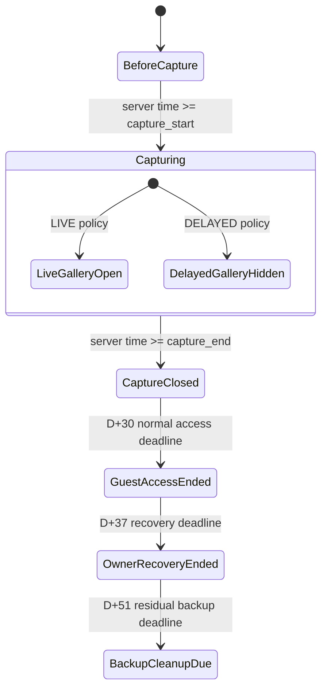
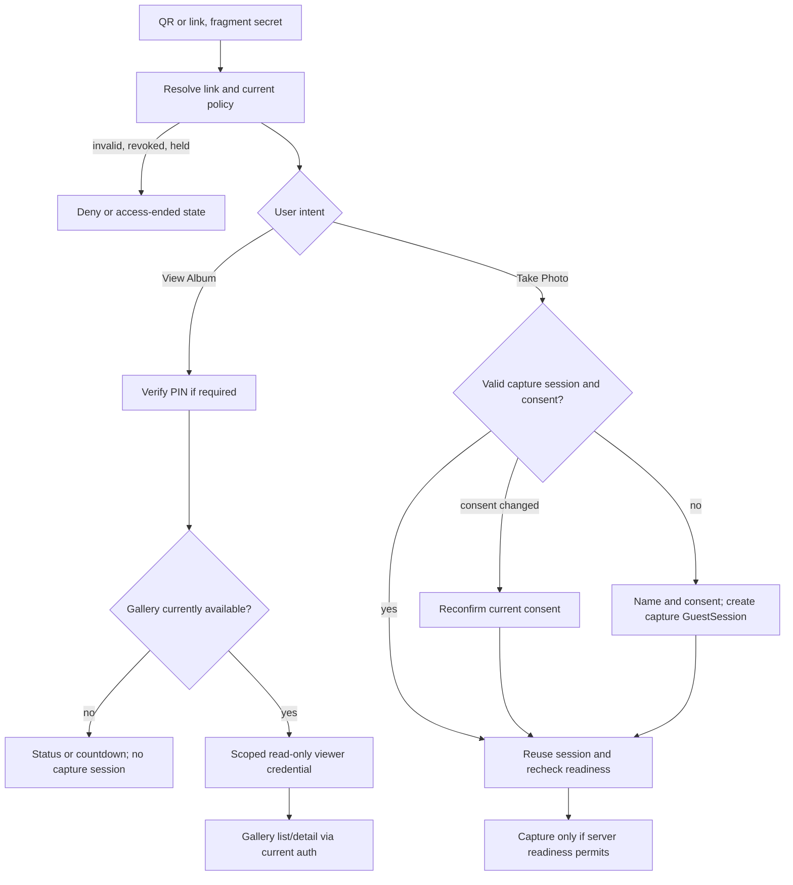
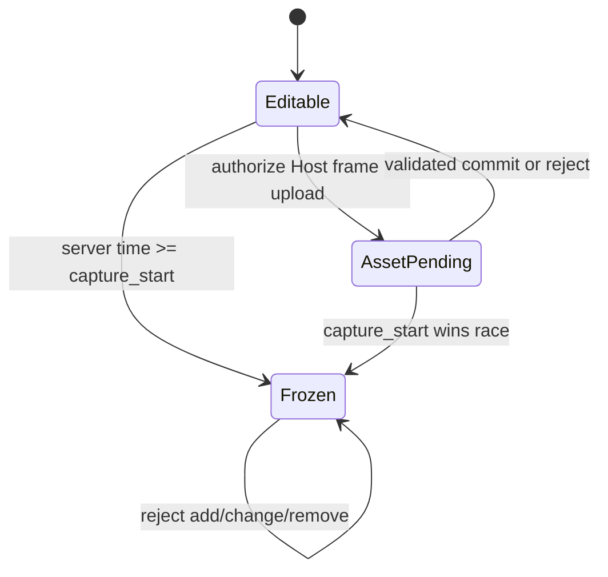

# Flow and state proposal

**OWNER APPROVED:** PD-01–13 behavior. **TECHNICAL PROPOSAL:** the state names, credential model and sequence below. Existing backend and OpenAPI do not implement these flows. Each server decision uses current server time, current album/photo state and current authorization.

## Independent clocks and eligibility

`capture_start` opens capture, `capture_end` closes new shutter, and an already authorized attempt may finish only within the existing five-minute grace. **TECHNICAL PROPOSAL:** a `LIVE` gallery gate can open at `capture_start` while capture is still OPEN; a `DELAYED` gate opens at server-derived `capture_end + delayDays`. A gallery opened during Live does not imply a photo is visible: each photo must be committed, `PUBLISHED`, not deleted/purged, allowed by album visibility/lifecycle/access version, and not under Operational Hold. Gateway repeats authorization at byte fetch. Empty eligible gallery is valid. Host pre-reveal access retains its existing separate permission path.

The diagram represents independent capture and gallery conditions; the transition at `capture_end` does **not** close a Live Gallery by itself. In Delayed mode the gallery becomes available at its own derived reveal time, possibly after capture is closed. Operational Hold, revoked link/PIN/credential, moderation changes and lifecycle can deny access at any point. No scheduled job may publish media without rechecking this state.

## Guest entry: two user intents

**OWNER APPROVED:** viewers give no name, have no capture session and are excluded from `guest_count_final`; capture guests still meet name and consent rules. **TECHNICAL PROPOSAL:** viewer credentials have `GALLERY_READ` only initially; existing capture session cookie is never treated as a viewer upgrade and viewer credentials never satisfy `/capture-attempts`. A returning valid capture session bypasses repeated name/consent only while its consent version remains current. If consent changes, obtain new consent without creating a second participant row unless the current contract specifically requires session replacement; that detail is Gate B. Expired/rotated credentials are not silently renewed. A viewer selecting “Take Photo” must enter the capture flow and satisfy its own checks. If gallery is unavailable, show state/countdown without issuing a usable gallery credential; final response details depend on Gate B.

## Frame selection and freeze

**OWNER APPROVED:** frame selection freezes at `capture_start`, including an empty selection. **TECHNICAL PROPOSAL:** only Owner/active collaborator with existing `can_setup` may authorize, commit and select design assets before the boundary; server compares its clock and current schedule/revision atomically on every mutation. A pending upload finishing after the boundary cannot become an active frame. Cover behavior after event is a separate existing design policy; the new prohibition applies specifically to frame changes. Frame bytes are private and validated as real PNG with alpha and exact orientation dimensions. Whether activation requires both variants is Gate C; the frontend must not silently omit an active frame on one orientation. Each CaptureAttempt references an immutable effective frame/design revision. This snapshot timing is part of Gate D/G: if the frame freezes at event start, a reserved attempt must never observe a different active frame on retry.

## Photo processing and commit

```mermaid
flowchart LR
  Reserve[Pre-shutter reservation] --> Capture[Browser camera capture]
  Capture --> LUT[One system LUT incl Normal]
  LUT --> Frame[Active orientation frame overlay if any]
  Frame --> Compress[JPEG compression <=700000 bytes]
  Compress --> Authorize[Short private upload authorization]
  Authorize --> PUT[Upload final bytes]
  PUT --> Commit[Idempotent server commit and moderation state]
  Commit --> Gate[Current Gallery eligibility]
  Gate --> Media[Gateway checks again on fetch]
```

Retake releases the reservation once and needs a new attempt before another shutter. Processing error, offline status or unavailable frame/LUT asset must not create a committed Photo; release/expiry follows existing quota rules. Retry of a PUT/commit for one attempt must not produce two Photos. The final persisted object is JPEG only, ≤700000 bytes; no permanent raw, separate frame overlay at delivery, or guest device upload. `INSTANT` moderation may yield `PUBLISHED` after commit; `APPROVAL` yields `PENDING` until authorized approval. Live publication follows that existing distinction; Gate E must explicitly approve any finer transition rules. Browser-only rendering cannot prove pixels match declared effect IDs; Gate D resolves compositor authority before enforcement claims.

## Failure, race and expiration table

| Event | Required behavior / proposed handling |
|---|---|
| Offline before entry, PIN or pre-shutter attempt | Do not claim access/capture; show localized retry state, no local queued photo upload. |
| Offline after valid reservation or during PUT/commit | Preserve existing retry/expiry semantics and idempotency; do not start another attempt silently. Recover by server status, not local assumption. |
| `capture_end` races with shutter | Server reservation/readiness is authoritative; no new shutter at/after end. Pre-authorized attempt may finish within five-minute grace. |
| `capture_start` races with frame upload/selection | Server clock and optimistic revision decide atomically; a late mutation fails without changing active frame. |
| Hold, link rotation, PIN change, session revoke, or D+30 | Deny new viewer/capture actions and subsequent Gallery/Gateway fetches; previously downloaded bytes cannot be recalled. |
| Photo hide/delete while ticket exists | Next Gateway fetch denies; cached or saved client copies are outside recall. |
| Reveal job runs late/early, reschedule, old album | Derive from current policy/schedule; supersede stale job. Never infer Live from `delayDays=0`. |
| Camera switch permission/device failure or route exit | Keep switch visible with honest unavailable/busy message, stop old tracks, ignore stale requests, avoid stream leak. |
| Large or malformed image/frame | Reject decoded dimensions, true alpha/MIME/magic/byte limit as applicable, prevent decompression abuse; do not consume committed quota. |

All UI states require localized ID/EN copy and keyboard/screen-reader behavior. Physical iPhone Safari and Android Chrome verification remains **BLOCKED/UNVERIFIED** until real devices and backend implementation are available.
